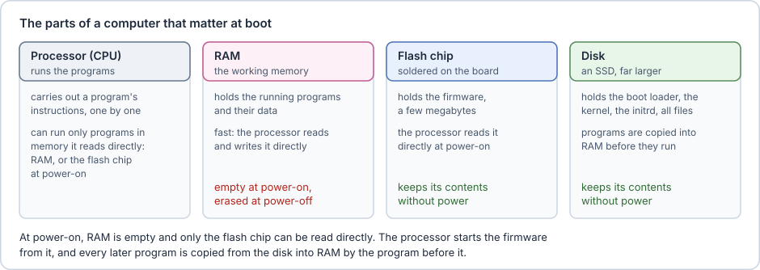
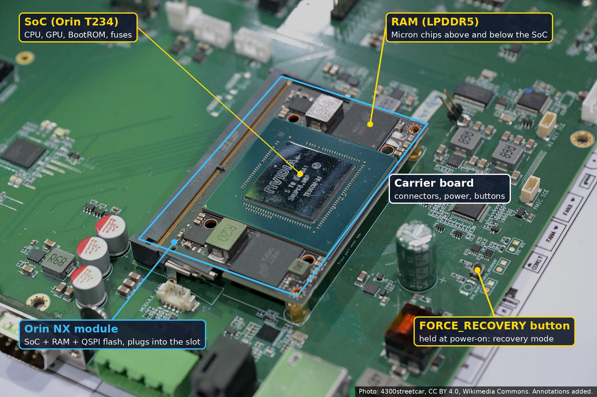
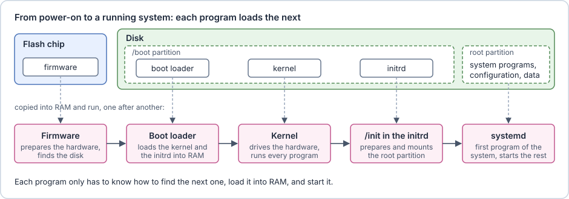
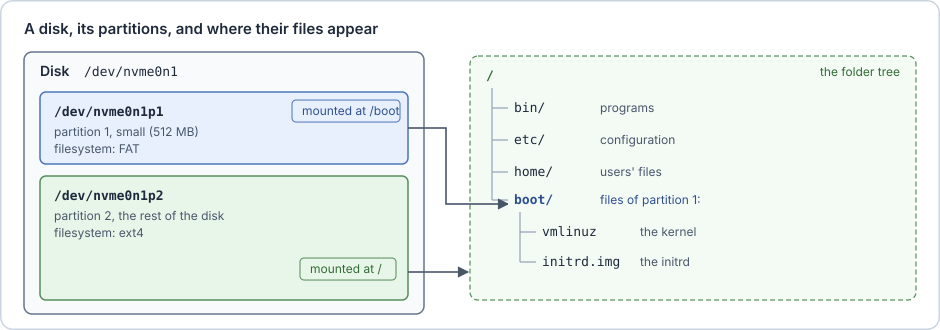
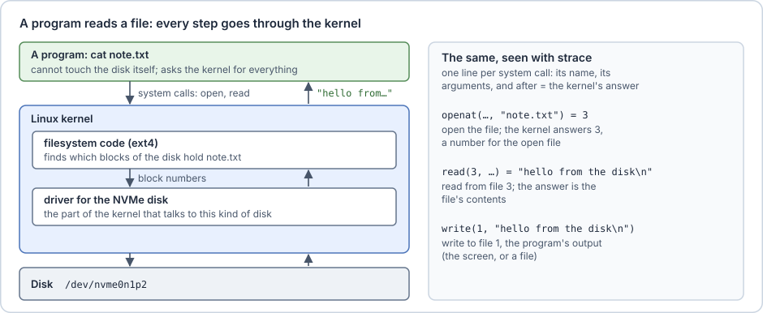
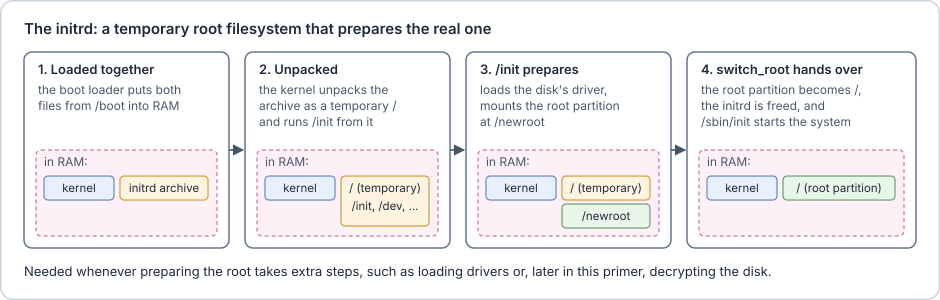

# Basics: how a Linux computer starts

This chapter introduces those programs that a computer runs when it is powered on one at a time.

**Try it** shows the same thing on any Linux computer with the expected output from a Linux computer.
**On the Jetson** shows what is expected on a Nvidia Jetson: the running example of this guide.

## The parts of a computer

The **processor**, or CPU (central processing unit), runs programs: it carries out a program's instructions, one after another. It can only run a program that sits in memory that it can read directly.

**RAM** (random-access memory) is the computer's working memory. It holds the programs that are running and the data they work on, and the processor reads and writes it directly and fast. RAM loses its contents when the power goes off, so at power-on it is empty.

The **disk** keeps its contents without power. It holds the operating system, the programs and the data, as files. Most disks today are **SSDs** (solid-state drives), made of flash memory. The processor cannot run a program straight from the disk: the program is first copied into RAM.

The **flash chip** is a small flash memory chip soldered on the board next to the processor, holding a few megabytes. It stores the **firmware**, the first program that runs. _The processor can read it directly at power-on_, before any program knows how to use the disk. In this guide, "the flash chip" always means this chip, not the disk.

> [!info] Flash memory
> **Flash memory** keeps its contents without power and can be erased and rewritten electrically. USB sticks, SSDs and the flash chip are all made of it. Because the flash chip can be rewritten, the firmware can be updated, and also replaced: later chapters return to this.



So at power-on, the only program the processor can start is the firmware in the flash chip. Every other program must first be copied from the disk into RAM, by a program that is already running.

> [!example]+ Try it: RAM and disks
> The kernel, introduced below, shows information about the computer as files in the folder `/proc`. `lsblk` lists the disks:
>
> ```console
> $ grep MemTotal /proc/meminfo
> MemTotal:       32504140 kB
> $ lsblk -d -e7 -o NAME,SIZE,TYPE
> NAME      SIZE TYPE
> nvme0n1 953.9G disk
> ```
>
> This laptop has 32 GB of RAM and one disk of about 1 TB. (`-d` shows whole disks only, `-e7` hides loop devices, which are files used as disks.)

> [!example] On the Jetson
> On the Jetson, the processor is part of a **SoC** (System on a Chip): one chip that holds the core of a computer, with the processor cores, the GPU, the memory controller, and the USB and PCIe controllers. The Orin SoC is called T234.
>
> The **Orin NX module** is a small card with the SoC, its RAM, and the flash chip, which holds all firmware. NVIDIA calls it the QSPI flash, after its interface: **QSPI** (Quad SPI) is a faster variant of **SPI** (Serial Peripheral Interface), a simple connection between chips on a board, using four data wires instead of one. The module plugs into a **carrier board** that has the connectors and the disk, an NVMe SSD (see [The carrier board port](11-addendum-jetson-secure-boot-on-nixos.md#The%20carrier%20board%20port)).
>
> 
> *An Orin NX module on a carrier board. This carrier selects recovery mode (see [Who checks the firmware](05-who-checks-the-firmware.md)) with a button; others use a jumper. Photo: [4300streetcar, Wikimedia Commons](https://commons.wikimedia.org/wiki/File:Nvidia_Jetson_Orin_NX_on_a_motherboard_Computex_2025.jpg), [CC BY 4.0](https://creativecommons.org/licenses/by/4.0/), annotations added.*

## The boot: one program loads the next

Starting a computer is called **booting**. At power-on, the computer runs a short sequence of programs. Each one is small and does one job: it prepares what the next program needs, copies the next program into RAM, and starts it.

On a Linux computer the sequence has four stages:
1. the firmware,
2. the boot loader,
3. the Linux kernel together with the initrd,
4. the root filesystem with its first program.

The figure shows where each one is stored and in which order they run. The sections below explain them one by one.



> [!example]+ Try it: how long each stage took
> `systemd-analyze` reports how long the last boot spent in each stage:
>
> ```console
> $ systemd-analyze
> Startup finished in 11.182s (firmware) + 4.247s (loader) + 11.384s (kernel) + 12.463s (userspace) = 39.278s
> graphical.target reached after 12.408s in userspace
> ```
>
> "loader" is the boot loader. On this laptop, "kernel" includes the time spent in the initrd, and "userspace" is the time the programs of the root filesystem took to start.

> [!example] On the Jetson
> The Orin runs the same four stages. Its firmware is a chain of several programs, described in [Who checks the firmware](05-who-checks-the-firmware.md). The boot loader is NVIDIA's L4TLauncher, the kernel and the initrd are files in `/boot`, and the root filesystem is Ubuntu with systemd.

## The firmware

The **firmware** is the first program of the boot, stored in the flash chip. It prepares the hardware: it sets up the RAM, the clocks and the devices on the board. Then it looks for a device to boot from, such as the disk or a USB stick, in the order given by its settings, and loads the boot loader from it.

The firmware keeps its settings, such as this boot order, in the flash chip too. Most firmware today follows a standard called **UEFI** (Unified Extensible Firmware Interface). UEFI defines how the firmware finds and starts the boot loader, and how it stores its settings, as **UEFI variables**. [Only signed software may run](04-only-signed-software-may-run.md) shows how UEFI checks what it starts.

Some processor chips run an even smaller program before the firmware, built into the chip itself. [Who checks the firmware](05-who-checks-the-firmware.md) returns to it.

> [!example]+ Try it: the firmware's variables
> Linux shows the firmware's UEFI variables as files. The folder `/sys/firmware/efi` exists only when the firmware is UEFI:
>
> ```console
> $ ls /sys/firmware/efi
> config_table
> efivars
> esrt
> fw_platform_size
> fw_vendor
> mok-variables
> runtime
> runtime-map
> systab
> $ ls /sys/firmware/efi/efivars | grep -E '^(BootOrder|SecureBoot)-'
> BootOrder-8be4df61-93ca-11d2-aa0d-00e098032b8c
> SecureBoot-8be4df61-93ca-11d2-aa0d-00e098032b8c
> ```
>
> `BootOrder` is the boot order. `SecureBoot` is a setting that [Only signed software may run](04-only-signed-software-may-run.md) explains. The long suffix is the same for all standard UEFI variables.

> [!example] On the Jetson
> The firmware sits in the QSPI flash on the module. It is several programs that run one after another, NVIDIA's MB1 and MB2 and finally UEFI. NVIDIA's tools write them into the flash chip over USB, from another computer; writing firmware into a flash chip is called **flashing**.

## Disks, partitions and filesystems

A disk is divided into **partitions**: separate areas, each used for one purpose. A small table at the start of the disk, the _partition table_, records where each partition starts and ends.

Each partition holds a **filesystem**, such as ext4 or FAT: a layout that organises the partition's blocks into files and folders.

Linux shows each disk and each partition as a special file in the folder `/dev`. For example, `/dev/nvme0n1` is the first NVMe disk (NVMe, short for Non-Volatile Memory Express, is the usual way to connect a fast SSD), and `/dev/nvme0n1p1` and `/dev/nvme0n1p2` are its first and second partitions.

**Mounting** a partition attaches its filesystem to a folder. Linux has a single folder tree, starting at `/`. The partition mounted at `/` is the **root partition**, and its filesystem is the **root filesystem**: the system programs and libraries, the configuration and the data. After `mount /dev/nvme0n1p1 /boot`, the files of the first partition appear under `/boot`. The kernel and the initrd usually sit on such a small partition, mounted at `/boot`.



> [!example]+ Try it: partitions and where they are mounted
> ```console
> $ lsblk -e7 -o NAME,SIZE,TYPE,FSTYPE,MOUNTPOINTS
> NAME            SIZE TYPE  FSTYPE      MOUNTPOINTS
> nvme0n1       953.9G disk
> ├─nvme0n1p1     512M part  vfat        /boot
> └─nvme0n1p2   953.4G part  crypto_LUKS
>   └─cryptroot 953.4G crypt ext4        /
> ```
>
> This laptop matches the figure, with one difference. Its second partition does not hold ext4 directly: it is encrypted (`crypto_LUKS`), and a decrypted view of it, `cryptroot`, holds the ext4 filesystem mounted at `/`. [Someone takes the disk](02-someone-takes-the-disk.md) explains how this works. `vfat` is Linux's name for FAT.

TODO: small callout about fstypes

> [!example] On the Jetson
> The disk is an NVMe SSD on the carrier board, so it appears as `/dev/nvme0n1`. In NVIDIA's standard setup, its first partition, called `APP`, holds the whole root filesystem, `/boot` included. With NVIDIA's disk encryption, `APP` keeps only `/boot`, and the root filesystem moves to a separate, encrypted partition.

## The boot loader

The **boot loader** is a small program that the firmware loads from the disk. It reads its own configuration file, which names the kernel and the initrd. It copies both into RAM and starts the kernel.

It also passes the kernel the **kernel command line**: a short line of text with settings. For example, `root=/dev/nvme0n1p2` tells the kernel which partition holds the root filesystem. On most PCs, the boot loader is GRUB or systemd-boot.

> [!example]+ Try it: the command line of the running kernel
> The kernel shows the command line it received in `/proc/cmdline` (the long partition IDs are shortened here):
>
> ```console
> $ cat /proc/cmdline
> BOOT_IMAGE=/vmlinuz-6.5.0-1025-oem root=UUID=… ro cryptdevice=UUID=…:cryptroot root=/dev/mapper/cryptroot quiet splash vt.handoff=7
> ```
>
> `BOOT_IMAGE` is the kernel file that the boot loader, GRUB, loaded. `root=` names the root filesystem, here by its UUID, a unique ID stored in the filesystem. `ro` mounts it read-only at first, and `quiet splash` show a logo instead of the boot messages. `cryptdevice=` belongs to the encrypted partition from the previous box.

> [!example] On the Jetson
> The boot loader is NVIDIA's **L4TLauncher**. Its configuration file is `/boot/extlinux/extlinux.conf`, which names the kernel, the initrd and the command line (shortened):
>
> ```
> LABEL primary
>       LINUX /boot/Image
>       INITRD /boot/initrd
>       APPEND ${cbootargs} root=/dev/nvme0n1p1 rw rootwait …
> ```
>
> `${cbootargs}` is replaced with settings from the firmware, and `root=` names the `APP` partition.

TODO mention that BOOT_IMAGE is not used when there is no Grub menu and neither the cryptdevice.

## The kernel

The **kernel** is the core of the operating system. It is the only program that talks to the hardware directly, and it runs every other program. A program that wants to read a file, send data over the network or start another program asks the kernel, through a **system call**.

When a program reads a file, the kernel's filesystem code finds which blocks of the disk hold the file. The **driver** for the disk, the part of the kernel that knows how to talk to one kind of device, fetches those blocks. The kernel then copies the bytes into the program's memory.



> [!example]+ Try it: watch the system calls
> `strace` runs a program and prints every system call it makes. Here `cat` copies a small file (the lines for loading the program's libraries are left out):
>
> ```console
> $ echo "hello from the disk" > note.txt
> $ strace -e trace=openat,read,write cat note.txt > copy.txt
> openat(AT_FDCWD, "note.txt", O_RDONLY)  = 3
> read(3, "hello from the disk\n", 131072) = 20
> write(1, "hello from the disk\n", 20)   = 20
> read(3, "", 131072)                     = 0
> +++ exited with 0 +++
> ```
>
> `cat` opens the file and gets the number 3 for it, reads 20 bytes, writes them to its output (here `copy.txt`), and reads once more: an empty answer means the end of the file. The kernel also describes the hardware as files, in `/sys`. This shows which driver handles the disk:
>
> ```console
> $ grep DRIVER /sys/block/nvme0n1/device/device/uevent
> DRIVER=nvme
> ```

> [!example] On the Jetson
> The kernel is the file `/boot/Image`: Linux with NVIDIA's drivers for the Orin. It is part of **L4T** (Linux for Tegra), NVIDIA's Linux for the Jetson.

## The initrd

The **initrd** (initial RAM disk) is a small archive of files that the boot loader loads into RAM together with the kernel.

The kernel unpacks it as a temporary root filesystem and runs the program `/init` inside it. `/init` prepares the real root filesystem, then hands over to it. A simplified `/init`, written as a shell script:

```sh
#!/bin/sh
mount -t devtmpfs none /dev            # show the disks as files in /dev
modprobe nvme                          # load the driver for the NVMe disk
mount /dev/nvme0n1p2 /newroot          # mount the root filesystem
exec switch_root /newroot /sbin/init   # make it the new /, start the system
```

A kernel with the right drivers built in can mount a simple root filesystem by itself. The initrd is needed as soon as preparing the root takes extra steps, such as loading drivers or, in [Someone takes the disk](02-someone-takes-the-disk.md), decrypting the disk.



> [!example]+ Try it: build a tiny initrd
> An initrd is a **cpio** archive (an archive format, like zip), usually compressed. This builds one that holds the `/init` script above, saved as the file `init`, and lists it:
>
> ```console
> $ mkdir -p toy-initrd/dev toy-initrd/newroot
> $ cp init toy-initrd/init && chmod +x toy-initrd/init
> $ (cd toy-initrd && find . | sort | cpio -o -H newc --quiet) | gzip > initrd.img
> $ zcat initrd.img | cpio -t --quiet
> .
> dev
> init
> newroot
> $ zcat initrd.img | cpio -i --quiet --to-stdout init | head -2
> #!/bin/sh
> mount -t devtmpfs none /dev            # show the disks as files in /dev
> ```
>
> `-H newc` selects the variant of cpio that the kernel unpacks. The real initrd of a Debian or Ubuntu computer can be listed the same way, with root rights: `sudo lsinitramfs /boot/initrd.img-$(uname -r)` shows its drivers, tools and scripts.

> [!example] On the Jetson
> The initrd is the file `/boot/initrd`. With NVIDIA's disk encryption, its `/init` also fetches the disk passphrase before it mounts the root filesystem (see [Where to keep the disk key](03-where-to-keep-the-disk-key.md)).

## The root filesystem and the first program

`switch_root` makes the root partition the new `/` and starts the first program of the real system, `/sbin/init`. On most Linux systems this is **systemd**. It runs as process number 1 until power-off, and it starts everything else: the services, the network, the logins, and Hari's software.

> [!example]+ Try it: process 1 and the root filesystem
> ```console
> $ ps -p 1 -o comm=
> systemd
> $ findmnt -o TARGET,SOURCE,FSTYPE /
> TARGET SOURCE                FSTYPE
> /      /dev/mapper/cryptroot ext4
> ```
>
> Process 1 is systemd, and `/` is the ext4 filesystem of the decrypted partition from the earlier box.

> [!example] On the Jetson
> The root filesystem is Ubuntu, from NVIDIA's L4T release, and its first program is systemd as well.

## Summary

| Program | Stored in | Started by | On the Jetson |
|---|---|---|---|
| Firmware | the flash chip | the processor, at power-on | MB1, MB2 and UEFI, in the QSPI flash |
| Boot loader | the disk | the firmware | L4TLauncher |
| Kernel | the disk, in `/boot` | the boot loader | `/boot/Image` |
| initrd | the disk, in `/boot` | the boot loader, with the kernel | `/boot/initrd` |
| systemd and everything else | the root filesystem | `/init`, through `switch_root` | Ubuntu (L4T) |

None of these programs checks anything: each one runs whatever it finds, and anyone who holds the disk can read every file. The story starts from there.

## Test your knowledge

> [!quiz]- Where is the firmware stored?
> - [ ] On the disk, in `/boot`
> - [x] In the flash chip on the board
> - [ ] In RAM
>
> The firmware is the first program of the boot, so it must sit where the processor can read it directly at power-on: the flash chip. Reading the disk needs a program that already runs, and RAM is empty at power-on.

> [!quiz]- Which program copies the kernel and the initrd into RAM?
> - [ ] The firmware
> - [x] The boot loader
> - [ ] The initrd
> - [ ] systemd
>
> The firmware loads the boot loader. The boot loader reads its configuration, loads the kernel and the initrd into RAM, and starts the kernel with the kernel command line.

> [!quiz]- What does `mount /dev/nvme0n1p1 /boot` do?
> - [ ] It erases the first partition and creates a new filesystem on it
> - [x] It makes the files of the first partition appear under `/boot`
> - [ ] It copies the folder `/boot` onto the first partition
>
> Mounting attaches a partition's filesystem to a folder of the single folder tree. Nothing is copied or erased.

> [!quiz]- A program wants to read a file. How does it get the file's contents?
> - [ ] It reads the disk blocks itself
> - [x] It asks the kernel, with system calls such as open and read
> - [ ] It asks the firmware
>
> Only the kernel talks to the hardware. Its filesystem code finds the file's blocks, the disk's driver fetches them, and the kernel copies the bytes into the program's memory.

> [!quiz]- Why does Linux need an initrd?
> - [ ] It keeps the kernel's drivers while the computer is off
> - [x] Preparing the root filesystem can take extra steps, such as loading drivers or decrypting the disk
> - [ ] It holds the users' files
>
> The initrd is a temporary root filesystem in RAM. Its program `/init` prepares the real root filesystem, and `switch_root` then hands over to it.
