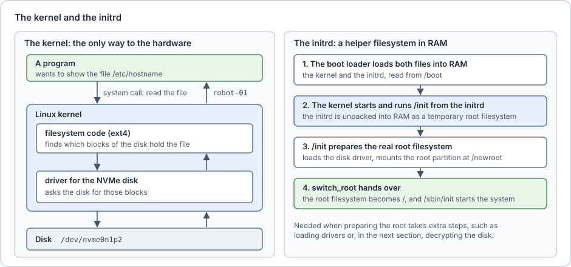
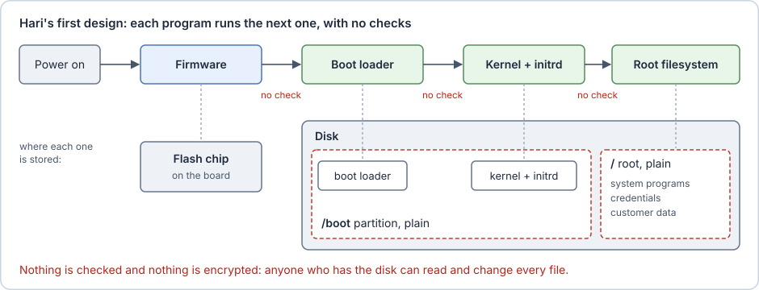

# A computer that boots

Sam's robot has a small computer: a processor, memory (RAM) and a disk. At power-on, the computer runs a sequence of programs, and each one loads the next:

1. **Firmware**: the first program, stored in a flash memory chip on the board. It prepares the hardware and finds the disk.
2. **Boot loader**: a small program on the disk that loads the kernel and the initrd into memory and starts the kernel.
3. **Linux kernel and initrd**: the kernel is the core of the operating system: it drives the hardware and runs every other program. The initrd is a small temporary filesystem loaded together with it, holding the tools that find and prepare the root filesystem. Both are files on the disk, kept apart from the root filesystem.
4. **Root filesystem**: the main filesystem, which the initrd mounts before handing over to it. It holds everything except the kernel and the initrd: the system programs and libraries, Sam's software, the configuration and the data.

The boxes below explain flash memory, partitions and filesystems, and the kernel and the initrd in more detail.

> [!info] Flash memory
> **Flash memory** keeps its contents without power and can be erased and rewritten electrically. USB sticks and SSDs are made of it. A computer board also carries a small flash chip, soldered next to the processor and holding a few megabytes, that stores the firmware. The processor reads this chip directly at power-on, before anything knows how to use the disk. Because the chip can be rewritten, the firmware can be updated, and also replaced: later sections return to this. In this primer, "the flash chip" always means this firmware chip, not the disk.

> [!info] Partitions and filesystems
> A disk is divided into **partitions**. Each partition holds a **filesystem**, such as ext4 or FAT, that organises it into files and folders. Linux shows each disk and each partition as a special file in the folder `/dev`. For example, `/dev/nvme0n1` is the first NVMe SSD (a fast type of flash disk), and `/dev/nvme0n1p1` and `/dev/nvme0n1p2` are its first and second partitions. **Mounting** a partition attaches its filesystem to a folder: after `mount /dev/nvme0n1p1 /boot`, the files of the first partition appear under `/boot`. The kernel and initrd usually sit on a small partition mounted at `/boot`. Everything else sits on the root partition, mounted at `/`.

> [!info] The kernel and the initrd
> The **kernel** is the only program that talks to the hardware directly. Every other program asks it for what it needs, through a **system call**. For example, when a program shows the file `/etc/hostname`, it asks the kernel to read the file. The kernel's filesystem code finds which blocks of the disk hold the file. The **driver** for the disk, the part of the kernel that knows how to talk to one kind of device, fetches those blocks. The kernel then copies the bytes back to the program.
>
> The **initrd** (initial RAM disk) is a small archive of files that the boot loader loads into RAM together with the kernel. The kernel unpacks it as a temporary root filesystem and runs the program `/init` inside it. `/init` prepares the real root filesystem, then hands over to it. A simplified `/init`, written as a shell script:
>
> ```sh
> #!/bin/sh
> mount -t devtmpfs none /dev            # show the disks as files in /dev
> modprobe nvme                          # load the driver for the NVMe disk
> mount /dev/nvme0n1p2 /newroot          # mount the root filesystem
> exec switch_root /newroot /sbin/init   # make it the new /, start the system
> ```
>
> `/sbin/init` is the first program of the real system, usually systemd, which starts everything else. A kernel with the right drivers built in can mount a simple root filesystem by itself. The initrd is needed as soon as preparing the root takes extra steps, such as loading drivers or, in the next section, decrypting the disk.
>
> 

Sam's first version is the simplest one that works. The firmware runs whatever boot loader it finds, the boot loader runs whatever kernel and initrd it finds in `/boot`, and the root filesystem is readable by anyone who has the disk.



The robot will spend its life in places Sam does not control. Someone can unplug it, carry it away, open the lid, pull out the disk, attach a USB cable, or plug into the debug serial header, a connector that gives a text console to the computer. The disk holds credentials, customer data such as images and maps, and Sam's software.

> [!example] On the Jetson
> The example computer in this primer is an NVIDIA Jetson Orin NX running JetPack 6, NVIDIA's software release for Jetson. Its Linux part is called L4T (Linux for Tegra). The disk is often an NVMe SSD. With NVIDIA's disk encryption, the kernel and initrd sit in `/boot` on a plain partition called `APP` (for example `nvme0n1p1`).
