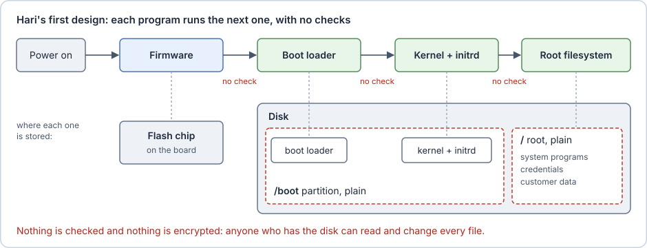

# Hari's first robot

Hari builds robots. Each one carries a small Linux computer like the one in [Basics](00-basics.md): firmware in a flash chip, then a boot loader, a kernel and an initrd from the disk, and a root filesystem that holds everything else: the system programs and libraries, Hari's software, the configuration and the data.

Hari's first version is the simplest one that works. The firmware runs whatever boot loader it finds, the boot loader runs whatever kernel and initrd it finds in `/boot`, and the root filesystem is readable by anyone who has the disk.

The robot will spend its life in places Hari does not control. Someone can unplug it, carry it away, open the lid, pull out the disk, attach a USB cable, or plug into the debug serial header, a connector that gives a text console to the computer. The disk holds credentials, customer data such as images and maps, and Hari's software.

> [!example] On the Jetson
> Hari's robots use the Jetson Orin NX from [Basics](00-basics.md), running JetPack 6, NVIDIA's software release for the Jetson, whose Linux part is L4T. Without disk encryption, the `APP` partition holds the whole root filesystem; the next chapter changes that.

## Test your knowledge

> [!quiz]- In Hari's first design, what does the boot loader check before it starts the kernel?
> - [ ] The kernel's signature
> - [ ] A password typed at boot
> - [x] Nothing: it runs whatever kernel and initrd it finds in `/boot`
>
> In the first version, no program checks the next one, and nothing is encrypted. The following chapters add one protection at a time.

> [!quiz]- Someone steals one of these robots. What can they do with its disk?
> - [ ] Nothing, without Hari's login password
> - [x] Connect it to a laptop and read every file
> - [ ] Read only the files in `/boot`
>
> The root filesystem is a plain partition. A login password only protects the running system: on another computer, every file is readable.
