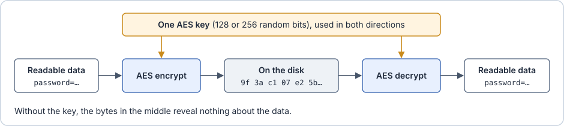
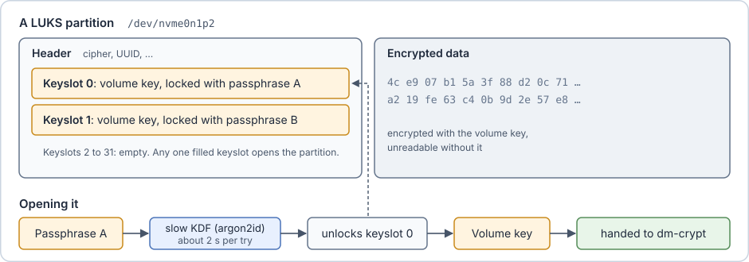
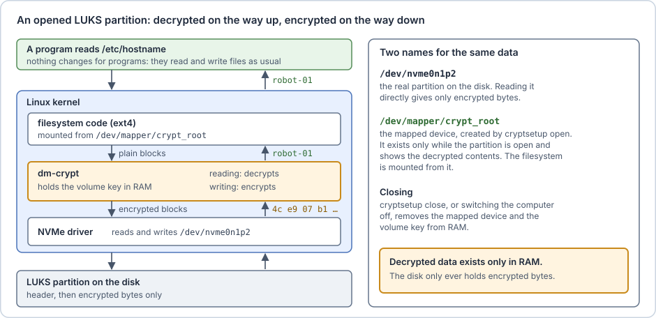
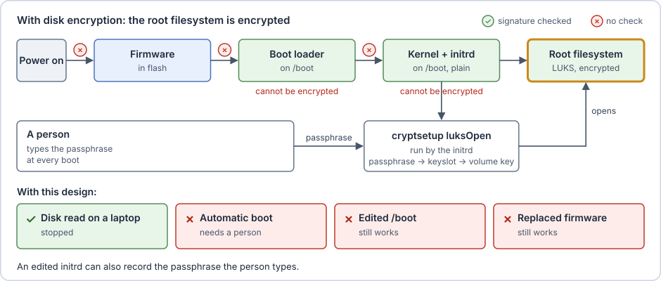

# Someone takes the disk

**The attack.** A thief removes the disk, connects it to a laptop and reads every file.

**The idea: disk encryption.** Hari stores the data encrypted. Without the key, the disk contains only random-looking bytes.

> [!info] Encryption and AES
> **Encryption** turns readable data into unreadable data using a **key**: a random number known only to its owner. Decryption with the same key turns the data back. When one key does both, the encryption is called **symmetric**.
>
> **AES** (Advanced Encryption Standard) is the symmetric encryption almost everything uses today, from disks to Wi-Fi. An **AES key** is 128 or 256 bits long. No existing computer can try all 2¹²⁸ possible keys, so the data is safe as long as the key stays secret. Whoever has the key can read everything.
>
> 

> [!info] LUKS and dm-crypt
> **LUKS** (Linux Unified Key Setup) is the standard format for encrypted partitions on Linux. **dm-crypt** is the part of the kernel that encrypts and decrypts, and `cryptsetup` is the tool that sets it up.
>
> A LUKS partition starts with a **header**, followed by the encrypted data. The data is encrypted with the **volume key**, a random AES key generated once and never stored in readable form. Instead, the header has up to 32 **keyslots**. Each keyslot holds a copy of the volume key, encrypted with a different passphrase. Any one passphrase opens the partition, so a recovery passphrase can be added, or a passphrase replaced, without re-encrypting the data. Losing the header loses the data, which is why `cryptsetup luksHeaderBackup` exists.
>
> **Why a slow step.** A passphrase chosen by a person is far easier to guess than a random AES key. Someone who copies the header can try passphrases on their own computers, and if each try were fast, they could try billions. So LUKS never uses the passphrase directly. It first passes it through a **key derivation function** (argon2id in LUKS2): a calculation that turns the passphrase into the key of its keyslot, made deliberately slow and memory-hungry. `cryptsetup` tunes it to take about two seconds on the computer that creates the partition. The owner waits two seconds once per boot. An attacker waits two seconds for every single guess, which makes working through a long list of passphrases impractical.
>
> 

> [!info] Opening a LUKS partition
> **Opening** a LUKS partition makes its contents usable while the disk keeps holding only encrypted data. The command `cryptsetup open` (older name: `luksOpen`) asks for a passphrase, unlocks a keyslot with it and takes out the volume key. It hands the volume key to dm-crypt, which keeps it in RAM and creates a virtual disk, a **mapped device**, shown as a file under `/dev/mapper`, for example `/dev/mapper/crypt_root`.
>
> The mapped device shows the decrypted contents. When the filesystem reads a block from it, dm-crypt reads the encrypted block from the real partition and decrypts it in RAM. When the filesystem writes a block, dm-crypt encrypts it before it goes to the disk. The filesystem is therefore mounted from the mapped device, never from the partition itself. **Closing** the partition (`cryptsetup close`, or switching the computer off) removes the mapped device and the volume key from RAM.
>
> 
>
> In the simplified `/init` script from [Basics](00-basics.md#The%20initrd), opening is one more line, and the mount uses the mapped device:
>
> ```sh
> #!/bin/sh
> mount -t devtmpfs none /dev
> modprobe nvme
> cryptsetup open /dev/nvme0n1p2 crypt_root   # asks for the passphrase
> mount /dev/mapper/crypt_root /newroot       # the decrypted view
> exec switch_root /newroot /sbin/init
> ```

With encryption, Hari's boot looks like this:



> [!warning] `/boot` cannot be encrypted
> In this design, the kernel and the initrd are the programs that open the encrypted disk, so they cannot be inside it: the firmware and the boot loader must read them before any key is available. `/boot` therefore stays a plain partition, and anyone who has the disk can read and change the kernel and the initrd. Whatever does the decrypting always stays unencrypted. A boot loader such as GRUB can decrypt `/boot` itself, but then the boot loader stays plain instead. Every following step deals with this gap.

> [!example] On the Jetson
> NVIDIA's disk encryption puts the root filesystem on a LUKS2 partition (for example `nvme0n1p2`). NVIDIA's flash tools default to the cipher `aes-cbc-essiv:sha256` with a 128-bit key. The modern default elsewhere is `aes-xts-plain64` with a 512-bit key (two 256-bit halves). The Orin's processor has instructions that make AES fast, so either one costs little.

**The new problem: the boot must be automatic.** At boot, the initrd needs the passphrase to open the root partition. On a laptop, the user types it. Hari's robot is a computer that boots automatically, with nobody present, so it must open its disk by itself.

## Test your knowledge

> [!quiz]- What does a LUKS keyslot hold?
> - [ ] The data, encrypted with the passphrase
> - [x] A copy of the volume key, encrypted with one passphrase
> - [ ] The passphrase, in readable form
>
> The data is encrypted once, with the volume key. Each keyslot locks a copy of that key with a different passphrase, so a passphrase can be added or replaced without re-encrypting the data.

> [!quiz]- Why does LUKS pass the passphrase through a slow key derivation function (argon2id)?
> - [ ] To make the data's encryption stronger than AES
> - [x] So that every guess costs an attacker about two seconds
> - [ ] Because the disk is slow anyway
>
> A passphrase chosen by a person is far easier to guess than a random key. The owner waits two seconds once per boot; an attacker waits two seconds for every passphrase on their list.

> [!quiz]- The partition is open. Where does the decrypted data exist?
> - [ ] On the disk, next to the encrypted data
> - [x] Only in RAM: dm-crypt decrypts each block as it is read
> - [ ] In the LUKS header
>
> The disk only ever holds encrypted bytes. The mapped device under `/dev/mapper` shows the decrypted contents, while dm-crypt holds the volume key in RAM.

> [!quiz]- Why can `/boot` not be encrypted in this design?
> - [ ] Its files are too small to encrypt
> - [x] The kernel and the initrd open the encrypted disk, so they must be readable before any key is available
> - [ ] FAT filesystems cannot be encrypted
>
> The firmware and the boot loader must read the kernel and the initrd before anything can decrypt. So anyone who has the disk can read and change them, a problem the following chapters solve.
