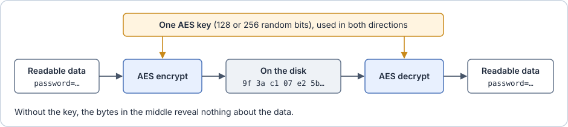
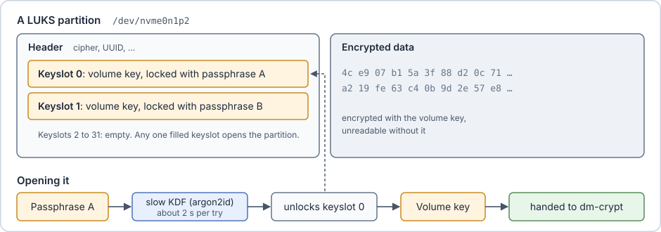
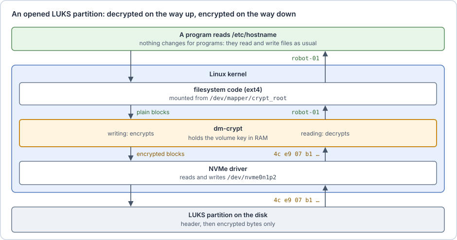
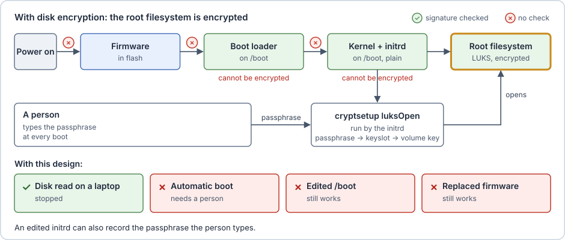

# Someone takes the disk

**The attack.** A thief removes the disk, connects it to a laptop and reads every file.

**The idea: disk encryption.** Hari stores the data encrypted. Without the key, the disk contains only random-looking bytes.

> [!info] Encryption and AES
> **Encryption** turns readable data into unreadable data using a **key**: a random number known only to its owner. Decryption with the same key turns the data back. When one key does both, the encryption is called **symmetric**.
>
> **AES** (Advanced Encryption Standard) is the symmetric encryption almost everything uses today, from disks to Wi-Fi. An **AES key** is 128 or 256 bits long. No existing computer can try all 2¹²⁸ possible keys, so the data is safe as long as the key stays secret. Whoever has the key can read everything.
>
> 

Hari has to decide two things: which parts of the disk to encrypt, and where the key comes from at every boot.

## What is encrypted, and which program decrypts it

Encrypted data is useless until a program decrypts it, and that program cannot be encrypted itself, because nothing could read it to start it. So Hari cannot encrypt the whole disk. Hari goes through the boot programs from [Basics](00-basics.md), in the order they run:

1. **The firmware** sits in the flash chip, not on the disk. It loads the boot loader from the disk and cannot decrypt anything, so the boot loader is stored unencrypted.
2. **The boot loader** reads the kernel and the initrd as two files from `/boot`. Hari keeps it as simple as it is: it does not decrypt either. So the kernel and the initrd are stored unencrypted as well, each one as a whole file.
3. **The kernel and the initrd** are therefore the programs that decrypt. The kernel gets the code that does the decrypting. The initrd's `/init` already prepares the root filesystem, so it also gets the key and hands it to the kernel.
4. **The root filesystem** is read only after that, so it can be encrypted. It is also where the secrets are: the credentials, the customer data and Hari's software.

So the disk keeps its two partitions, like the laptop in [Basics](00-basics.md#Disks,%20partitions%20and%20filesystems): a small `/boot` partition that stays plain, and the root partition, which is encrypted from now on.

Once the kernel has the key, it decrypts every block it reads from the root partition and encrypts every block it writes, in RAM. Programs notice nothing: they read and write files as before. The disk itself only ever holds encrypted bytes.

## Two keys: one for the data, one to lock it

The data is encrypted with AES, so at every boot the kernel needs an AES key. RAM is empty at power-on, so the key has to come from somewhere.

**First attempt: a passphrase is the key.** A person types a passphrase at boot, and it is used directly as the key for the data. This has two problems. Changing the passphrase means decrypting the whole disk and encrypting it again, which takes hours. And there can be only one passphrase, with no second one for recovery.

**Second attempt: a random key for the data, locked with a passphrase.** Hari gives the two jobs to two keys:

1. When the disk is prepared, a random AES key is generated, the **volume key**. All the data is encrypted with it, and it never changes.
2. The volume key is needed again at every boot, so Hari stores it on the disk, in front of the data. Stored as it is, the thief would read it and decrypt everything. So the volume key is encrypted too, again with AES, this time with a key computed from the passphrase.
3. At boot, the passphrase decrypts the volume key, and the volume key decrypts the data.

Changing the passphrase now means encrypting the volume key again, which is a few bytes instead of a whole disk. Several passphrases can open the same disk as well: the disk holds several copies of the volume key, each encrypted with a different passphrase.

Linux has this design built in, under the name LUKS.

> [!info] LUKS and `dm-crypt`
> **LUKS** (Linux Unified Key Setup) is the standard format for encrypted partitions on Linux. Two pieces of software work with it:
>
> - **dm-crypt** is the part of the kernel that decrypts and encrypts the blocks, with AES and the volume key.
> - `cryptsetup` is an ordinary program, run with root rights. It creates LUKS partitions and opens them.
>
> A LUKS partition starts with a **header**, followed by the encrypted data. The header has up to 32 **keyslots**. Each keyslot holds one copy of the volume key, encrypted with AES, with a key computed from one passphrase. The volume key is never stored in readable form. Any one passphrase opens the partition, so a recovery passphrase can be added, or a passphrase replaced, without encrypting the data again. The header holds the only copies of the volume key, so losing the header loses the data.
>
> **Why a slow step.** A passphrase chosen by a person is far easier to guess than a random AES key. Someone who copies the header can try passphrases on their own computers, and if each try were fast, they could try billions. So LUKS never uses the passphrase directly. It first passes it through a **key derivation function** (argon2id in LUKS2): a calculation that turns the passphrase into the AES key of its keyslot, made deliberately slow and memory-hungry. `cryptsetup` tunes it to take about two seconds on the computer that creates the partition. The owner waits two seconds once per boot. An attacker waits two seconds for every single guess, which makes working through a long list of passphrases impractical.
>
> 

> [!info] Opening a LUKS partition
> **Opening** a LUKS partition makes its contents usable while the disk keeps holding only encrypted data. The command `cryptsetup open` (older name: `luksOpen`) asks for a passphrase, unlocks a keyslot with it and takes out the volume key. It hands the volume key to `dm-crypt`, which keeps it in RAM and creates a virtual disk, a **mapped device**, shown as a file under `/dev/mapper`, for example `/dev/mapper/crypt_root`.
>
> The mapped device shows the decrypted contents. When the filesystem reads a block from it, `dm-crypt` reads the encrypted block from the real partition and decrypts it in RAM. When the filesystem writes a block, `dm-crypt` encrypts it before it goes to the disk. The filesystem is therefore mounted from the mapped device, never from the partition itself. **Closing** the partition (`cryptsetup close`, or switching the computer off) removes the mapped device and the volume key from RAM.
>
> 
>
> In the simplified `/init` script from [Basics](00-basics.md#The%20initrd), opening is one more line, and the mount uses the mapped device:
>
> ```sh
> #!/bin/sh
> mount -t devtmpfs none /dev
> modprobe nvme
> cryptsetup open /dev/nvme0n1p2 crypt_root   # asks for the passphrase
> mount /dev/mapper/crypt_root /newroot       # the decrypted view
> exec switch_root /newroot /sbin/init
> ```

**Who does what, and when.** Each step above belongs to one program and to one moment:

| When | Who | What happens |
|---|---|---|
| Once, when the robot is prepared | Hari, on a running Linux, with `cryptsetup luksFormat` | The header is written: a new random volume key, locked in the first keyslot with the passphrase. Hari then opens the partition, creates the filesystem in it and copies the files. |
| At every boot | The firmware and the boot loader | Nothing new. The boot loader loads the kernel and the initrd from the plain `/boot`. Neither program knows that the other partition is encrypted. |
| At every boot | The initrd: `/init` runs `cryptsetup open` | The passphrase unlocks a keyslot, and the volume key goes to `dm-crypt`. `/init` then mounts the root filesystem and hands over to it. |
| From then until power-off | The kernel: `dm-crypt` | Every block read from the partition is decrypted, and every block written is encrypted. |

The other `cryptsetup` commands are for maintenance. The owner runs them on the running system: `cryptsetup luksAddKey` adds a passphrase in a free keyslot, and `cryptsetup luksHeaderBackup` saves a copy of the header to a file.

With encryption, Hari's boot looks like this:



> [!warning] `/boot` cannot be encrypted
> In this design, the kernel and the initrd are the programs that open the encrypted partition, so they cannot be inside it: the firmware and the boot loader must read them before any key is available. `/boot` therefore stays a plain partition. The kernel and the initrd are stored there unencrypted, each as a whole file, and anyone who has the disk can read and change them. Whatever does the decrypting always stays unencrypted. A boot loader such as GRUB can decrypt `/boot` itself, but then the boot loader stays plain instead. Hari's next task is to deal with this gap.

> [!info] Ciphers and modes
> A **cipher** is a method of encryption: the exact calculation that turns data and a key into encrypted data, and back. AES is a cipher.
>
> AES by itself encrypts one small block of 16 bytes. A **mode** is the rule for encrypting more than one block with it, here a whole disk. **The mode makes the result depend on where the data sits on the disk**, so the same data stored in two places gives different encrypted bytes.
>
> `cryptsetup` writes the cipher and the mode as one name:
>
> - `aes-xts-plain64` is AES in the mode **XTS**, which was made for disks. XTS uses two AES keys, so its 512-bit key is two 256-bit AES keys.
> - `aes-cbc-essiv:sha256` is AES in the older mode **CBC**.
>
> The last part of each name says how the position on the disk enters the calculation. The LUKS header records the name, so `cryptsetup open` knows how the data was encrypted.

> [!example] On the Jetson
> NVIDIA's disk encryption puts the root filesystem on a LUKS2 partition (for example `nvme0n1p2`). NVIDIA's flash tools default to the cipher `aes-cbc-essiv:sha256` with a 128-bit key. The modern default elsewhere is `aes-xts-plain64` with a 512-bit key (two 256-bit halves).

**The new problem: the boot must be automatic.** At boot, the initrd needs the passphrase to open the root partition. On a laptop, the user types it. Hari's robot is a computer that boots automatically, with nobody present, so it must open its disk by itself.

## Test your knowledge

> [!quiz]- What does a LUKS keyslot hold?
> - [ ] The data, encrypted with the passphrase
> - [x] A copy of the volume key, encrypted with one passphrase
> - [ ] The passphrase, in readable form
>
> The data is encrypted once, with the volume key. Each keyslot locks a copy of that key with a different passphrase, so a passphrase can be added or replaced without re-encrypting the data.

> [!quiz]- Why does LUKS pass the passphrase through a slow key derivation function (argon2id)?
> - [ ] To make the data's encryption stronger than AES
> - [x] So that every guess costs an attacker about two seconds
> - [ ] Because the disk is slow anyway
>
> A passphrase chosen by a person is far easier to guess than a random key. The owner waits two seconds once per boot; an attacker waits two seconds for every passphrase on their list.

> [!quiz]- The partition is open. Where does the decrypted data exist?
> - [ ] On the disk, next to the encrypted data
> - [x] Only in RAM: dm-crypt decrypts each block as it is read
> - [ ] In the LUKS header
>
> The disk only ever holds encrypted bytes. The mapped device under `/dev/mapper` shows the decrypted contents, while dm-crypt holds the volume key in RAM.

> [!quiz]- Why can `/boot` not be encrypted in this design?
> - [ ] Its files are too small to encrypt
> - [x] The kernel and the initrd open the encrypted disk, so they must be readable before any key is available
> - [ ] FAT filesystems cannot be encrypted
>
> The firmware and the boot loader must read the kernel and the initrd before anything can decrypt. So anyone who has the disk can read and change them, a problem the following chapters solve.
