# Where to keep the disk key

**First attempt: a key file in the initrd.** Hari puts the passphrase in a file inside the initrd, which passes it to `cryptsetup`. The robot now opens its disk by itself. But the initrd sits on the plain `/boot` partition: the thief reads the key file and opens the disk on a laptop. The key must not be on the disk.

**Second attempt: a key in the board's flash chip.** A thief who takes only the disk is now stopped. A thief who takes the whole robot is not: the flash chip can be read with a flash programmer, or the robot can be started with another operating system that reads it. Anything the operating system can read, an attacker running another operating system can read too.

## The key inside the processor chip

Hari's first idea: keep a secret inside the processor chip. On the board, the chips talk to each other over wires, and wires can be tapped or chips read out. A secret that never leaves the processor chip cannot be read that way. So Hari wants a small storage area inside the processor chip itself, written once when the robot is prepared and impossible to change afterwards. Chips already contain such storage: fuses.

**What the fuses hold.** Not the disk key itself, but a **root key** from which the disk passphrase is computed at boot. The passphrase has to be handed to Linux at every boot, because `cryptsetup` runs in Linux. If it were the fused key itself, Linux would see that key, and a single leak would expose it for the life of the device, since fuses cannot change. A key computed from the fused key can be handed out, replaced (for example for a new disk), and made different for every purpose, while the root key itself stays inside the chip. The LUKS volume key does not move either: it stays in the LUKS header, locked in a keyslot, and the computed passphrase unlocks that keyslot. [Putting the two parts together](#Putting%20the%20two%20parts%20together) shows the whole chain.

The processor chip on the Jetson is a SoC, a single chip with the processor cores and most controllers (see [The parts of a computer](00-basics.md#The%20parts%20of%20a%20computer)).

> [!info] Fuses
> A **fuse** in a chip is a microscopic link of conducting material between two contacts, built into the silicon. A small sense circuit next to it checks whether current flows through the link: an intact link conducts and reads as 0. To store a 1, a programming circuit on the same chip sends a short, strong current pulse through the link. The link heats up and breaks, like an overloaded household fuse. A broken link no longer conducts, reads as 1, and cannot be repaired. Writing a fuse this way is called **burning** it. Because they are programmed electrically, these fuses are also called **eFuses**.
>
> A row of fuses stores a value: 256 fuses hold a 256-bit key. The programming circuit is switched on only while a device is prepared, through a dedicated tool. On the Jetson, that tool is NVIDIA's `odmfuse.sh` (ODM: original design manufacturer, like OEM a name for the company that builds a product around the chip). Some fuses can be read by any software, some only by protected code (part 2 below), and some never: they only drive the hardware. **A key in fuses never travels over the wires of the board, so a flash programmer cannot read it**.
>
> 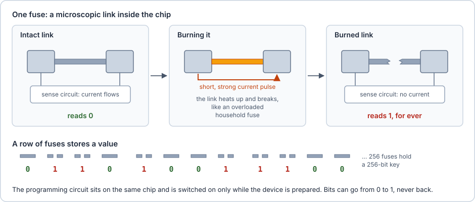

## A part of the processor that Linux cannot reach

Hari's second idea completes the first. A key in a fuse is not enough on its own. If Linux can read the fuse, so can any operating system the attacker boots instead of Linux. The key must be readable only by code that runs on the same processor but outside the reach of whatever operating system is running. Hari designs that protection into the processor itself:

1. The processor gets a second, protected mode next to the normal mode that runs Linux.
2. Every memory access the processor makes carries a flag saying which mode made it. Some memory, and some devices such as the circuit that reads the key fuses, are reserved for the protected mode. Hardware in front of them checks the flag and refuses accesses from the normal mode.
3. A small trusted program runs in the protected mode and keeps the key. Linux can enter the protected mode only through one special instruction that jumps to a fixed entry point of that program. So Linux can ask the program questions, but cannot read its memory or run code of its own in the protected mode.
4. At power-on, the processor starts in the protected mode. The boot puts the trusted program into the reserved memory and sets up the checks first, and only then switches to the normal mode to start Linux. Linux therefore never runs while the protected mode is being set up.

Hari does not have to build this: Arm processors already contain exactly this design, and Arm calls it TrustZone.

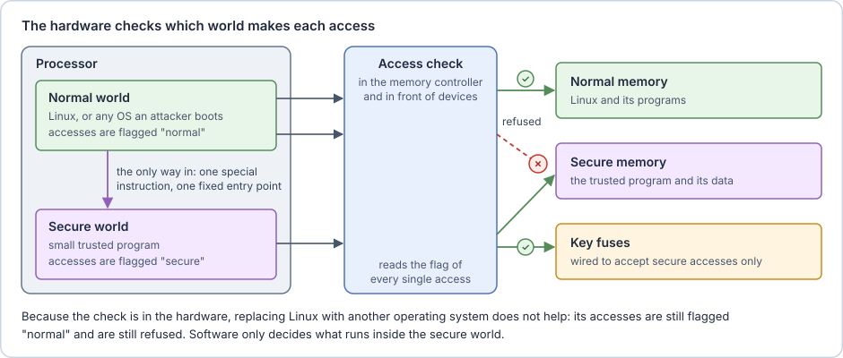

> [!info] Arm TrustZone
> **TrustZone** is Arm's implementation of the protected mode above. It is a hardware feature, not a software abstraction. The processor runs either in the **normal world** (Linux and everything on it) or in the **secure world** (trusted code). The next section shows how the hardware keeps the two apart.
>
> The special instruction that enters the secure world is called **SMC** (Secure Monitor Call). It lands in a small piece of firmware, **ATF** (Arm Trusted Firmware), which switches the processor between the two worlds.
>
> Software only decides what runs inside the secure world. Usually that is a small operating system, **OP-TEE** (Open Portable Trusted Execution Environment). Programs inside OP-TEE are called **trusted applications (TAs)**. A Linux program that asks a TA for something is a **client application (CA)**, and it sends its request through the kernel driver `/dev/tee0`. The TA decides what to answer.

## How the hardware keeps the worlds apart

Point 2 of Hari's design carries the whole idea: the check happens in hardware, so no software can skip it. This section looks at where that check physically sits.

**Inside the SoC, every access is a request on a network.** The processor cores, the GPU, the DMA engines (circuits that copy data without the processor) and the device controllers all sit on the same piece of silicon. An on-chip network called the **interconnect** connects them. When a core reads memory, it sends a request over the interconnect: the address, whether it is a read or a write, how many bytes, and a few extra signals. One of those extra signals is a single bit, the **NS bit** (non-secure): 1 for an access from the normal world, 0 for one from the secure world.

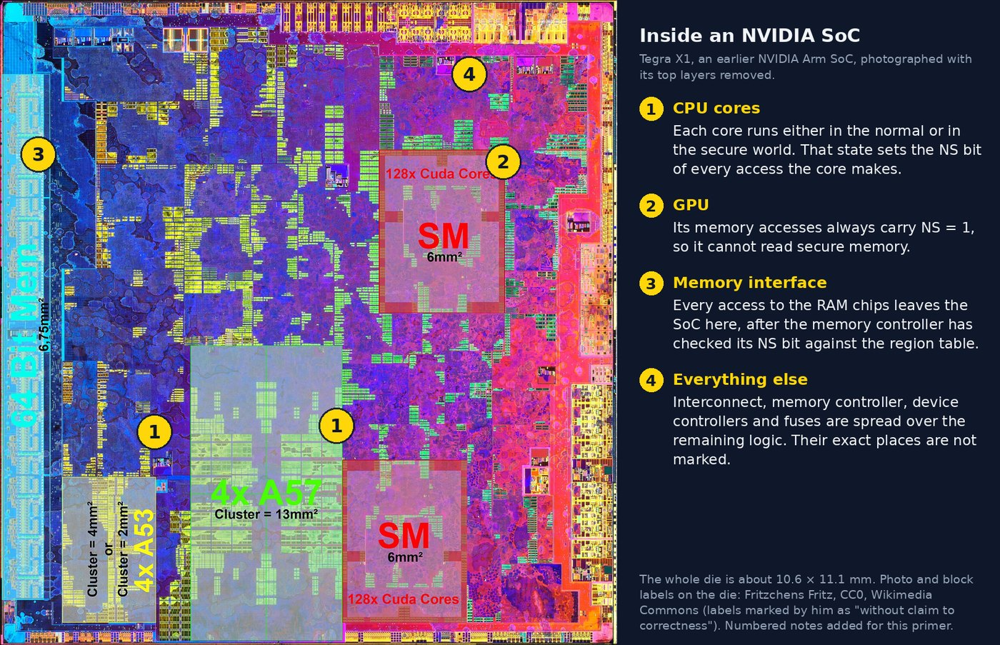

**Nobody can fake the bit.** The world is a hardware state of the core, and the core sets the NS bit from that state. Normal-world code has no instruction that changes it: the only way into the secure world is the SMC instruction, which jumps to code chosen by the secure world. So every access that Linux, or an operating system the attacker wrote, can produce carries NS = 1.

**Gates stand in front of what must be protected.** Between the interconnect and the RAM sits a gate in the memory controller. It holds a table of the address ranges that belong to the secure world, and compares every access against it. Devices that hold secrets, such as the key fuses or the key slots of the crypto engine, sit behind similar gates or answer secure accesses only. A refused access never reaches its target: depending on the chip, a read returns zeros or a bus error, and a write is dropped.

The gate's table, the **region table**, describes each range by its first and last address. Addresses are written in hexadecimal (base 16, marked by the prefix `0x`), and the underscore only groups the digits for reading. For every request, the gate makes two checks: it finds the range that contains the requested address, then it applies that range's rule to the NS bit. The figure follows one read from Linux through both checks.

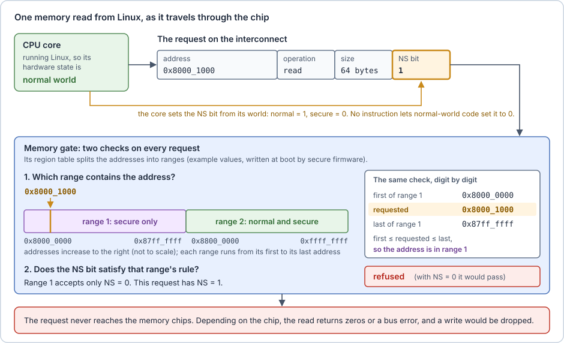

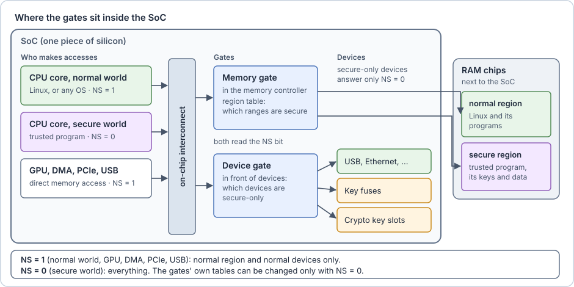

| Access from                             | Normal memory and devices | Secure memory and devices |
| --------------------------------------- | ------------------------- | ------------------------- |
| Normal world (Linux, or any OS), NS = 1 | allowed                   | **refused**               |
| GPU, PCIe and USB devices, NS = 1       | allowed                   | **refused**               |
| Secure world, NS = 0                    | allowed                   | allowed                   |

**The side doors are closed too.**

- **Devices that access memory directly.** The GPU, DMA engines and PCIe devices read memory without going through the processor. Their requests carry an NS bit as well, and the chip's wiring sets it to 1 (see below), so a malicious PCIe card cannot read secure memory either.
- **Caches.** The processor keeps copies of recently used memory in its caches. Each cached copy is tagged with the NS bit of the access that loaded it, so secure data in a cache stays invisible to the normal world.

**Where each NS bit comes from.** No program writes the NS bit into a request. It is a wire of the interconnect, and the chip designer decides, when designing the chip, what drives that wire at each entry point of the interconnect:

- **Processor cores** drive it from their world state, a bit stored in the core. Only a world switch, done by ATF, changes that bit.
- **Devices without a secure mode**, such as the GPU and the PCIe and USB controllers, have the wire connected to the supply voltage, which is a constant 1. The connection is part of the silicon: no register controls it, so no software can change it. A PCIe card plugged into the board sends its requests through the PCIe controller, so they get NS = 1 too.
- **Devices that can work for both worlds**, such as some DMA engines or a crypto engine, take it from a configuration register. That register sits behind a device gate, so only the secure world can set it, at boot.

The interconnect also stamps each request with the ID of the entry point it came in through. A gate can then also allow or refuse accesses per device, for example "only the crypto engine may use this memory range".

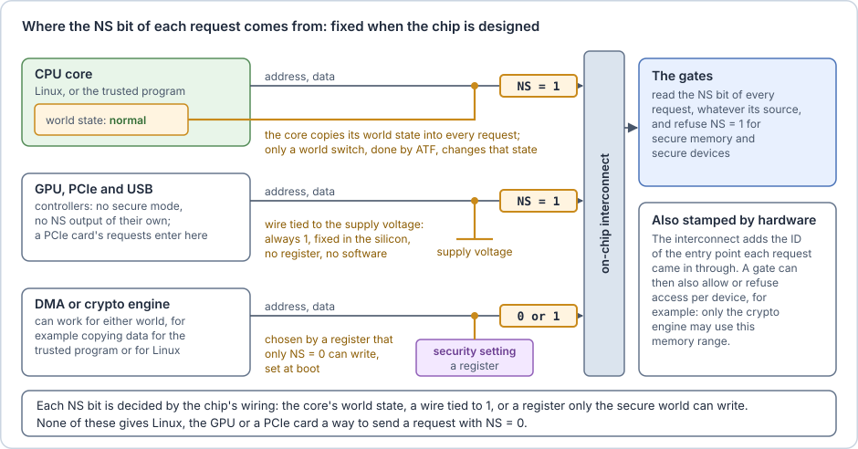

**The gates are set up once, early in the boot**, before Linux starts (the next section shows by whom). The gates' own configuration registers answer secure accesses only, and many chips can also lock them until the next reset. After that, nothing Linux does can move the boundary.

In Arm's reference designs, the memory gate is the **TrustZone Address Space Controller** (TZASC) and the device gate the **TrustZone Protection Controller** (TZPC). Chip makers often build their own equivalents. On Arm's on-chip bus standard (AMBA AXI), the NS bit is one of the protection signals that travel with every request.

> [!example] On the Jetson
> NVIDIA's memory controller implements the memory gate with **carveouts**: address ranges reserved by NVIDIA's early boot stages, each with its own access rules. The secure world runs from the carveout called **TZDRAM**. The **OEM key fuses** are readable only by secure accesses. OEM (original equipment manufacturer) means the company that builds a product around the chip, here Hari rather than NVIDIA: these fuses are reserved for that company's own keys. The key slots of NVIDIA's crypto engine (the Security Engine) can be restricted in the same way.

## How the trusted program gets into the secure world

Linux cannot write to secure memory, so the trusted program cannot be installed from Linux. It gets there in two steps. Once, when the device is prepared, it is written into the board's flash chip. Then, at every power-on, the boot copies it from the flash chip into secure memory, before Linux exists.

**The secure-world image.** The trusted program is ordinary software written by others: ATF comes from Arm's open-source Trusted Firmware project, OP-TEE from its own open-source project, and the TAs from the chip maker or from Hari. Hari combines them into one file, the **secure-world image**. The TAs that must be available from the start, such as the one that keeps the disk key, are built into it.

**Once: flashing.** Writing software into a flash chip is called **flashing**. To prepare the device, Hari connects it with a USB cable to another computer that runs the chip maker's flashing tool. The tool writes all firmware into the flash chip: the first boot programs, the secure-world image, and the rest of the firmware. To accept software over USB, the chip is started in a special **recovery mode** (described in [Who checks the firmware](05-who-checks-the-firmware.md)). The fuses are burned in the same session, with a separate tool.

**At every power-on: loading.** The trusted program must be in secure memory before Linux can ask it anything, and Linux cannot put it there. Arm processors solve this with one rule: at power-on, the processor starts in the secure world. The boot then runs in this order:

1. The processor starts in the secure world. Nothing runs in the normal world yet.
2. The first boot programs set up the RAM and the gates: the region table marks the secure part of the RAM.
3. They copy the secure-world image from the flash chip into the secure part of the RAM and start it.
4. They load the next boot program into normal memory and switch the processor to the normal world to run it. The switch goes one way: from then on, the only way back is the SMC instruction, which lands in ATF.
5. The boot loader starts Linux. Linux can send requests to the trusted program, but cannot read or change it.

The secure world is filled before the normal world exists.

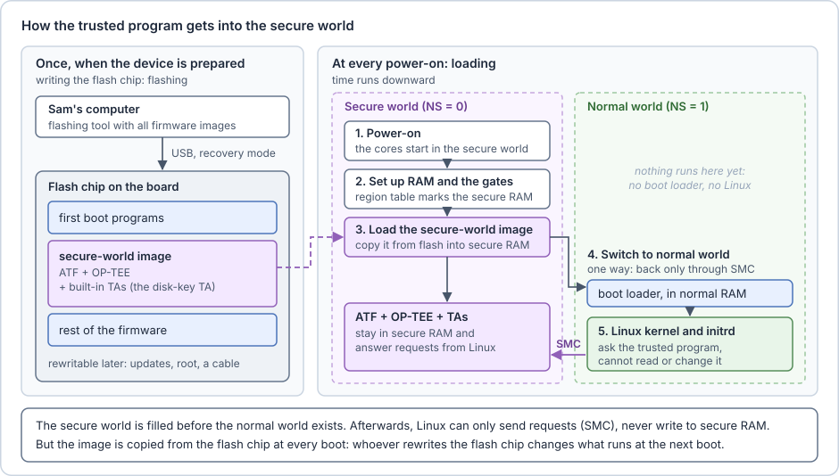

**TAs loaded later.** Not every TA has to be built into the image. OP-TEE can also load a TA from a file that Linux hands over. OP-TEE copies the file into secure memory and runs it only if it carries a valid signature (see [Only signed software may run](04-only-signed-software-may-run.md)). Linux delivers the file but cannot change what runs.

> [!example] On the Jetson
> - The flashing tool is NVIDIA's `flash.sh` (or `l4t_initrd_flash.sh` when the disk is an NVMe SSD), run on a Linux PC with the module in recovery mode.
> - ATF and OP-TEE are packed into one image, `tos-optee_t234.img` (TOS: trusted OS). It is written to the QSPI partitions `A_secure-os` and `B_secure-os`: two copies, so that an update can fall back to the old one. The `luks-srv` TA is built into it.
> - NVIDIA ships a prebuilt image. Changing the built-in TAs means rebuilding it from NVIDIA's OP-TEE sources.
> - At boot, NVIDIA's early boot stages set up the carveouts and copy the image into TZDRAM before UEFI starts (see [Who checks the firmware](05-who-checks-the-firmware.md)).

> [!warning] What the gates cannot do
> The gates protect the secure world from Linux while the device runs. They do not protect the flash chip. An update tool, an attacker with root rights, a flash programmer or the flashing tool can write a different secure-world image, and the boot copies it into secure memory at the next power-on just as faithfully. The same holds for the first boot programs, which set up the gates themselves. So the secure world is only as trustworthy as the firmware in the flash chip, and that firmware must be checked before it runs: the subject of [Who checks the firmware](05-who-checks-the-firmware.md).

## Putting the two parts together

> [!info] Key derivation
> A **key derivation function (KDF)**, already met in LUKS, computes a new key from an existing key or passphrase and some extra input, called the **context**. The same inputs always give the same result, and the result does not reveal the original key. With different contexts, one secret key gives many unrelated keys.

With both parts, Hari burns a root key into fuses that only the secure world can read. At boot, a TA derives the disk passphrase from that key and gives it to the initrd, which opens the LUKS partition with it as before. Linux never sees the fused key, and copying the disk or the flash chip reveals nothing.

**More keys than fuses.** The disk is not the only secret on the robot. The trusted program may need other keys as well, for example for the TPM of a later section, or to prove the robot's identity to a server. Fuses cannot hold them all: a chip has room for only a few keys, and a burned fuse never changes, while keys sometimes have to be replaced. So Hari gives the root key a single job: protecting other keys. Hari puts all the other keys into one file, encrypts it with a key derived from the root key, and adds a check value that reveals any change to the file (it is **authenticated**). The file is stored in the flash chip and is called a **key blob**. Anyone can read the flash chip, but without the root key the blob is only random-looking bytes, and a modified blob is rejected. Changing a key means flashing a new blob, while the fuses stay as they are.

This is the trick of the LUKS keyslots again, one level up. There, a passphrase protects the volume key stored in the LUKS header. Here, the root key protects the keys stored in the flash chip.

**The chain at boot.** The TA decrypts the key blob, takes out the **disk key**, and derives the disk passphrase from it with a KDF. The context is the chip's unique ID and the ID of the encrypted partition, so the passphrase differs for every robot and every disk, even if several robots share the same disk key. The initrd then opens the LUKS partition with that passphrase, as in [Someone takes the disk](02-someone-takes-the-disk.md). The figure shows the whole chain, where each key is stored, and its name on the Jetson.

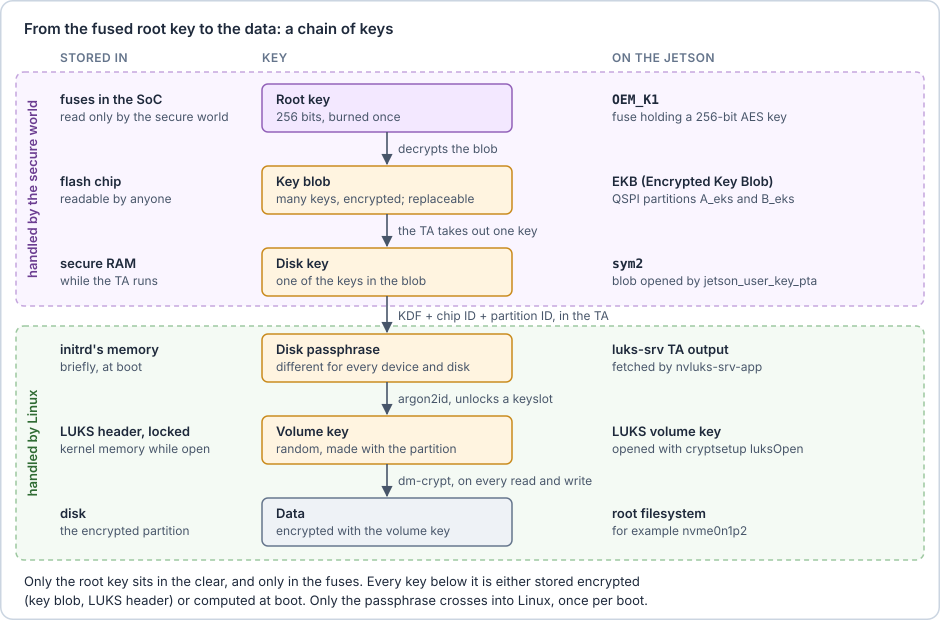

> [!warning] What ends up in Linux's memory
> The root key never leaves the secure world, but two keys derived from it do pass through normal memory:
>
> - **The passphrase**, briefly, at boot. The TA hands it to the initrd, which passes it to `cryptsetup`. `cryptsetup` erases its copy once the keyslot is unlocked.
> - **The volume key**, for as long as the disk is open. dm-crypt needs it for every read and write, so it stays in the kernel's memory until the computer shuts down. On a running system, root can even print it with `dmsetup table --showkeys`.
>
> So this design protects the key while the robot is switched off or booting, not while it runs (see [What none of this protects](07-what-none-of-this-protects.md)). Someone with root on a running robot can read the volume key. With physical access, the running RAM can be attacked too: by cooling the RAM chips and reading them in another computer before their contents fade (a **cold boot attack**), or with a malicious device that reads memory directly (a **DMA attack**), which an **IOMMU**, a unit that limits the memory each device may access, can stop. This is also why the TA answers only once per boot, and why the next sections make sure that only Hari's software runs around that moment.
>
> Some systems keep the volume key out of normal memory altogether. The secure world loads it directly into an encryption engine on the path to the disk, and Linux only ever handles an encrypted form of it. Linux calls these **hardware-wrapped keys**. The Jetson's standard disk encryption hands the passphrase to `cryptsetup` as described here, so its volume key does sit in kernel memory.

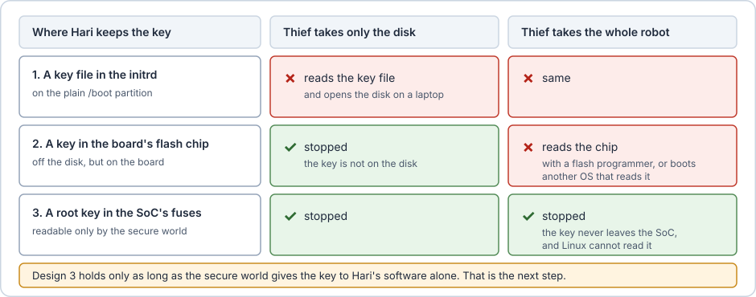

> [!example] On the Jetson
> Each key of the chain has a Jetson name:
> - **Root key:** the fuse **OEM_K1** (`OemK1` in the fuse configuration file) holds a 256-bit AES key that only the secure world can read.
> - **Key blob:** the **EKB** (Encrypted Key Blob), stored in the QSPI partitions `A_eks` and `B_eks` (two copies, see A/B slots in the [Glossary](12-glossary.md)). It is encrypted and authenticated with keys derived from OEM_K1. At boot, `jetson_user_key_pta`, a TA built into OP-TEE itself (a pseudo TA, or PTA), decrypts it. The keys inside never leave the secure world.
> - **Disk key:** the key `sym2` in the EKB. The `luks-srv` TA derives the disk passphrase from it with a KDF (NIST SP 800-108). The context is the chip's unique ID (the **ECID**, which is not secret) and the UUID of the encrypted partition.
> - **Handing over the passphrase:** the initrd runs `nvluks-srv-app`, the CA, which asks `luks-srv` for the passphrase and pipes it into `cryptsetup luksOpen`. Then it runs `nvluks-srv-app -n` (`SRV_DOWN`): the TA stops answering until the next reboot, so nothing started later can ask again.
> - `tee-supplicant` is a Linux program that stores files for OP-TEE, which has no filesystem of its own. OP-TEE encrypts and authenticates the files before they reach the disk.
> - **As long as OEM_K1 is not burned**, OP-TEE uses a default test key (all zeros), and anyone can decrypt the EKB with NVIDIA's public tool `gen_ekb.py`. See [A default Jetson setup, examined](09-a-default-jetson-setup-examined.md).

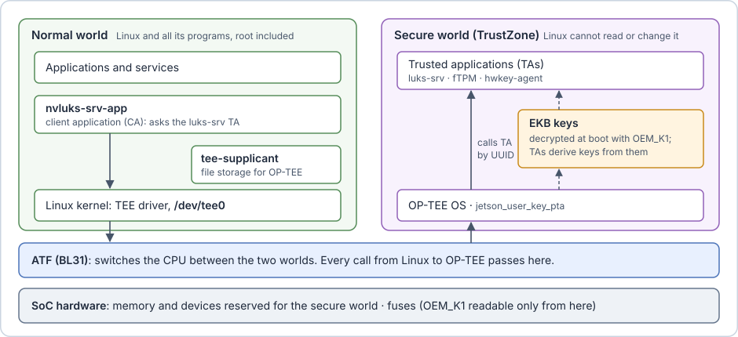

With the key in the secure world, Hari's boot looks like this:

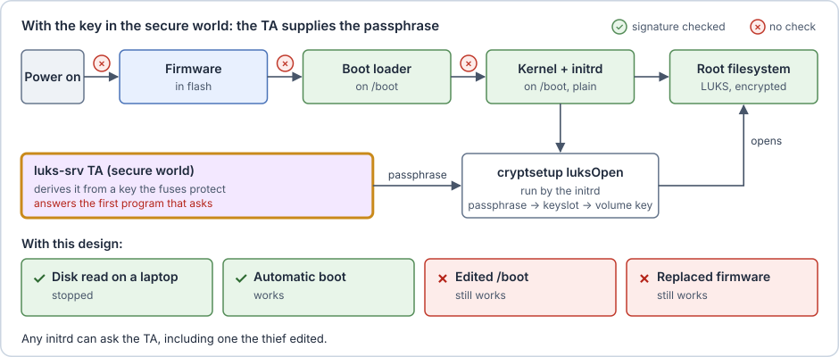

**What is still missing.** The TA answers the first program that asks after power-on. It cannot tell whether that program is Hari's initrd or a modified one, and the initrd still sits on the plain `/boot` partition. The secure-world image is also copied from the flash chip at every boot, so whoever rewrites the flash chip changes the secure world too (see [Who checks the firmware](05-who-checks-the-firmware.md)).
