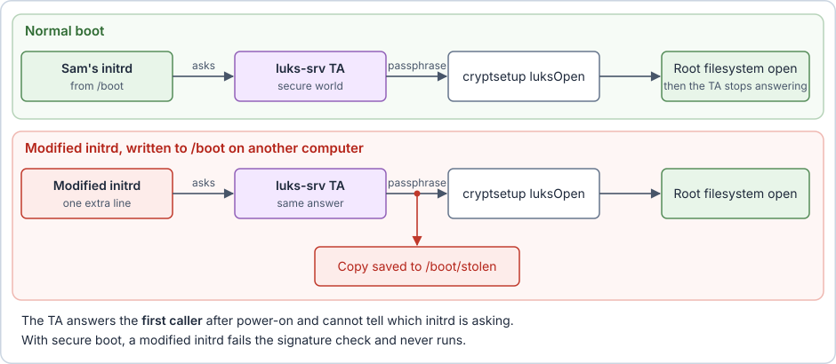
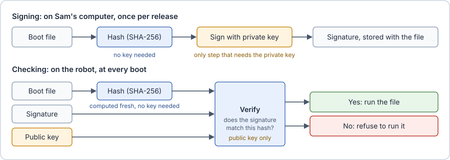
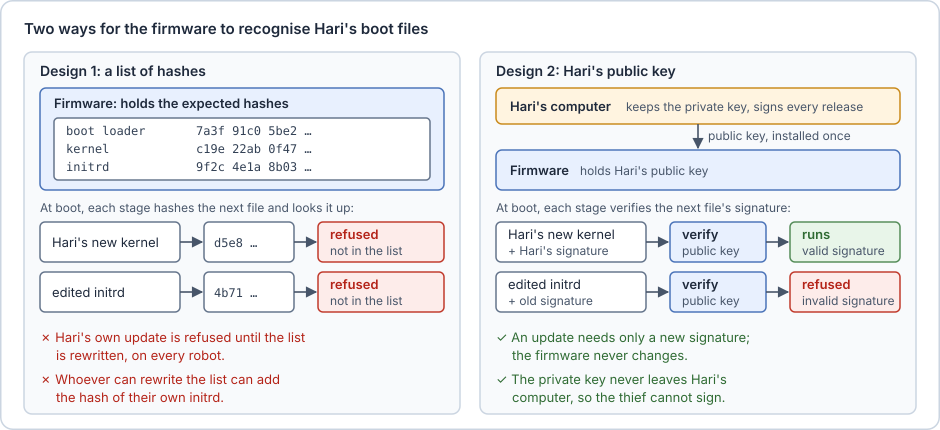
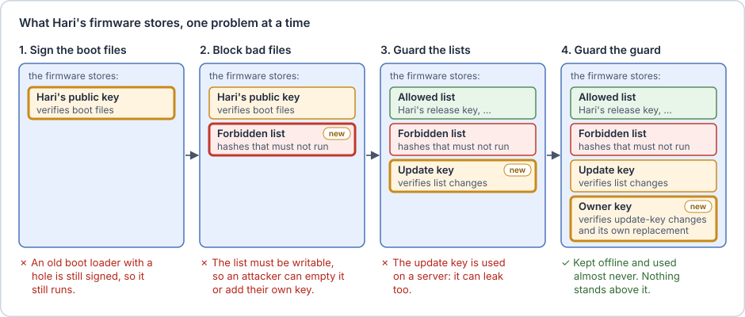
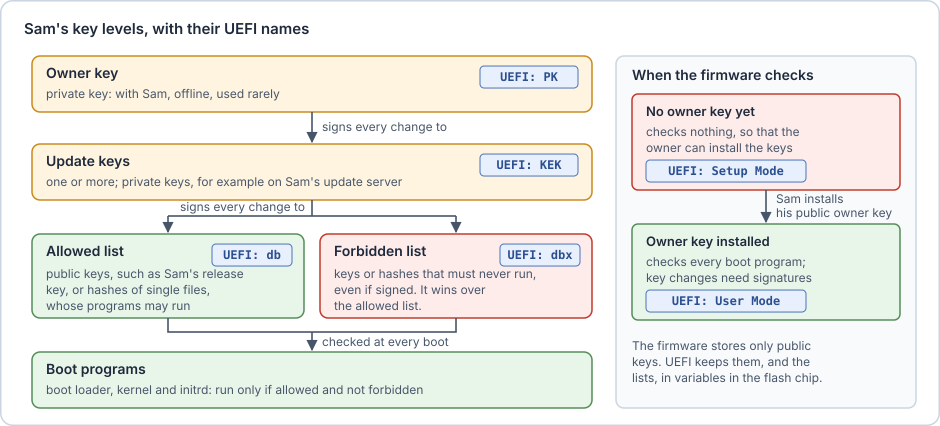
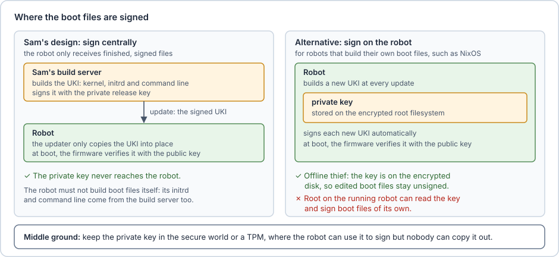
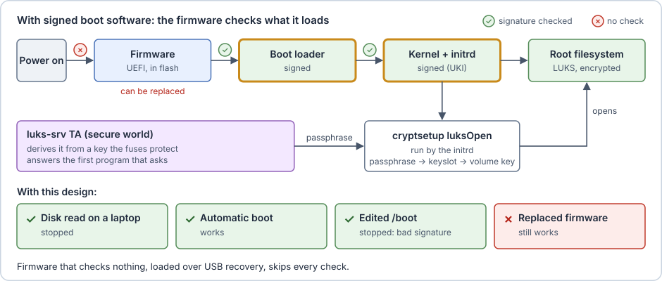

# Only signed software may run

**The attack.** The thief takes the disk out, adds one line to the initrd on `/boot` that saves a copy of the passphrase, puts the disk back and boots the robot once. The TA gives the passphrase to the modified initrd, which opens the disk as usual and also saves the copy. The thief then reads the copy and opens the disk on a laptop.



**Sam's first idea: fingerprints.** Sam wants the boot to refuse any boot file that is not his. Keeping a safe copy of every file to compare against would take a lot of space. A short fingerprint of each file is enough, and mathematics provides one: the hash.

> [!info] Hashes
> A **hash function** turns a file of any size into a short value of fixed size, its **hash**. SHA-256, the most common one, gives 32 bytes, usually written as 64 hexadecimal digits. Two properties make the hash a fingerprint: changing a single bit of the file changes the hash completely, and nobody can, in practice, build a different file with the same hash. A hash uses no key: anyone can compute it.
>
> ```console
> $ sha256sum initrd            # Sam's initrd
> 9f2c4e1a8b03…  initrd
> $ sha256sum initrd            # after the thief added one line
> 4b71d0c8e95a…  initrd
> ```

Sam computes the hash of the boot loader, the kernel and the initrd on his own computer and stores the list of expected hashes in the firmware. At boot, the firmware computes the hash of the boot loader before running it and compares it with the list. The boot loader then does the same for the kernel and the initrd. Each stage checks the next one before running it, so the checks form a **chain**. The thief's initrd has a different hash, and the boot loader refuses to run it.

The chain cannot start with a check of the firmware itself: a modified firmware would simply skip its own check. For now Sam trusts the firmware, and [Who checks the firmware](05-who-checks-the-firmware.md) returns to it.

**The problem: updates.** Every new kernel or initrd has a new hash. With a list of hashes, every update must also rewrite the list in the firmware of every robot, or the firmware refuses Sam's own new kernel. And because the list must be rewritable for updates, whoever can rewrite it, such as an attacker with root rights, can add the hash of their own initrd. Sam wants a rule that stays the same across updates: "run whatever Sam approved".

**Sam's second idea: a mark only Sam can make.** Sam needs to attach to each approved file a mark that only he can produce, but that the firmware can check. Mathematics provides this too: the digital signature.

> [!info] Digital signatures
> A **digital signature** works with a **key pair**: two keys generated together. The **private key** stays secret with its owner and is used to **sign**: from the file's hash and the private key, a short value is computed, the **signature**, which is stored next to the file or inside it. The **public key** can be given to anyone and is used to **verify**. The verifier computes the hash of the file itself, and the public key tells whether the signature was made, with the matching private key, for exactly that hash. So the expected hash never has to be stored anywhere: it is bound into the signature, and only the private key could have produced a signature for it.
>
> Only one of the three operations needs the private key:
>
> | Operation              | Needs           | Who can do it | In Sam's design                                   |
> | ---------------------- | --------------- | ------------- | ------------------------------------------------- |
> | **Hash** a file        | no key          | anyone        | Sam's computer when signing, the firmware at boot |
> | **Sign** a hash        | the private key | only Sam      | Sam's computer, once per release                  |
> | **Verify** a signature | the public key  | anyone        | the firmware, at every boot                       |
>
> So the firmware hashes and verifies without ever holding the private key. The thief can hash and verify too, but cannot sign. The public key cannot create signatures, and the private key cannot be computed from it. If the file changes after signing, its hash changes and the verification fails.
>
> ```console
> $ openssl genpkey -algorithm RSA -out sam.key          # Sam's key pair (private key)
> $ openssl pkey -in sam.key -pubout -out sam.pub        # the matching public key
> $ openssl dgst -sha256 -sign sam.key -out initrd.sig initrd                # sign, on Sam's computer
> $ openssl dgst -sha256 -verify sam.pub -signature initrd.sig initrd        # verify, anywhere
> Verified OK
> $ cp initrd initrd-thief && echo "save the passphrase" >> initrd-thief     # the thief's edited copy
> $ openssl dgst -sha256 -verify sam.pub -signature initrd.sig initrd-thief  # verify it with Sam's signature
> Verification failure
> ```
>
> 

Sam generates a key pair on his own computer. The public key goes into the firmware, and the private key never goes onto the robot. Sam signs every boot loader, kernel and initrd he releases. At boot, each stage verifies the signature of the next one with the public key before running it. An update now needs only a new signature, made on Sam's computer, and the firmware stays the same. The robot receives each update already signed, and never signs anything itself. The thief can still change the initrd, but cannot sign it.



> [!example]+ Toy example: a firmware that checks signatures
>
> The next steps grow a small model of the firmware that runs on any Linux computer with `openssl`. Any small files can stand in for `initrd` and the boot loaders. The folder `firmware/` stands for what the firmware stores, and the script `boot_check.sh` for its check: it runs a file only if the public key in `firmware/` verifies the file's signature.
>
> ```sh
> # boot_check.sh: the toy firmware's check
> f=$1
> if openssl dgst -sha256 -verify firmware/sam.pub -signature "$f.sig" "$f" >/dev/null 2>&1
> then echo "$f: runs"; else echo "$f: refused"; fi
> ```
>
> Sam installs his public key from the example above once. The toy firmware then checks Sam's signed initrd, and the thief's edited copy with Sam's signature attached:
>
> ```console
> $ mkdir firmware && cp sam.pub firmware/
> $ sh boot_check.sh initrd
> initrd: runs
> $ cp initrd.sig initrd-thief.sig            # the thief attaches Sam's signature
> $ sh boot_check.sh initrd-thief
> initrd-thief: refused
> ```

**The next problem: a signed file that turns out to be bad.** Months later, someone finds a security hole in a boot loader that Sam signed and released. Sam releases a fixed version, but the old one still carries a valid signature. A thief can put the old boot loader back on the disk, and the firmware runs it, because Sam's public key still verifies it. Sam needs a way to say "not this file, even though it is signed". So he adds a **forbidden list** to the firmware: the hashes of signed files that must no longer run. The firmware now runs a boot program only if its signature verifies with Sam's public key and its hash is not on the forbidden list.

> [!example]+ Toy example: the forbidden list
>
> Sam signs two releases of the boot loader. The first one has the hole, and the toy firmware runs it:
>
> ```console
> $ for f in bootloader-v1 bootloader-v2; do openssl dgst -sha256 -sign sam.key -out $f.sig $f; done
> $ sh boot_check.sh bootloader-v1
> bootloader-v1: runs
> ```
>
> Sam adds a forbidden list, `firmware/forbidden.txt`, with one hash per line, and the check consults it first:
>
> ```sh
> # boot_check.sh, step 2: also refuse any file whose hash is forbidden
> f=$1
> h=$(sha256sum < "$f" | cut -d' ' -f1)
> if grep -qx "$h" firmware/forbidden.txt; then echo "$f: refused, forbidden"; exit; fi
> if openssl dgst -sha256 -verify firmware/sam.pub -signature "$f.sig" "$f" >/dev/null 2>&1
> then echo "$f: runs"; else echo "$f: refused"; fi
> ```
>
> ```console
> $ sha256sum < bootloader-v1 | cut -d' ' -f1 >> firmware/forbidden.txt
> $ sh boot_check.sh bootloader-v1
> bootloader-v1: refused, forbidden
> $ sh boot_check.sh bootloader-v2
> bootloader-v2: runs
> ```

**Changing what the firmware stores.** The forbidden list has to grow each time a new hole is found, long after the robot left Sam's workshop, so it must be writable. Sam's public key may need to change too: Sam may move to a new key pair, or allow a second signer, such as a partner who builds a boot loader. So the single public key becomes an **allowed list** of public keys. But whatever Sam can write, an attacker with root rights can write as well. They could empty the forbidden list to bring the old boot loader back, or add their own public key to the allowed list. Sam applies his own idea once more: the firmware accepts a change to either list only if Sam signed the change with his private key, and verifies that signature with his public key before applying it.

> [!example]+ Toy example: signed changes to the lists
>
> So far, anyone can write to `firmware/`, an attacker with root rights included:
>
> ```console
> $ : > firmware/forbidden.txt                # the attacker empties the forbidden list
> $ sh boot_check.sh bootloader-v1
> bootloader-v1: runs
> ```
>
> Sam reorganises the toy firmware. The allowed list becomes a folder of public keys, and the check accepts a signature made with any of them:
>
> ```sh
> # boot_check.sh, step 3: any key in the allowed list may have signed the file
> f=$1
> h=$(sha256sum < "$f" | cut -d' ' -f1)
> if grep -qx "$h" firmware/forbidden.txt; then echo "$f: refused, forbidden"; exit; fi
> for k in firmware/allowed/*.pub; do
>   openssl dgst -sha256 -verify "$k" -signature "$f.sig" "$f" >/dev/null 2>&1 && { echo "$f: runs"; exit; }
> done
> echo "$f: refused"
> ```
>
> From now on, nothing writes to `firmware/` directly. The only way in is `change.sh`, which adds an entry to a list only if Sam's key signed the entry. In a real firmware, the lists can be written only through the firmware itself, which makes this check.
>
> ```sh
> # change.sh, step 3: add an entry to a list, only if Sam's key signed it
> list=$1; entry=$2
> openssl dgst -sha256 -verify firmware/allowed/sam.pub -signature "$entry.sig" "$entry" >/dev/null 2>&1 \
>   || { echo "change refused"; exit; }
> if [ "$list" = allowed ]; then cp "$entry" firmware/allowed/; else cat "$entry" >> firmware/forbidden.txt; fi
> echo "change accepted"
> ```
>
> Sam forbids the old boot loader again, this time with a signed change. Then the attacker tries to add their own public key, signed with their own private key:
>
> ```console
> $ mkdir firmware/allowed && mv firmware/sam.pub firmware/allowed/
> $ sha256sum < bootloader-v1 | cut -d' ' -f1 > entry
> $ openssl dgst -sha256 -sign sam.key -out entry.sig entry
> $ sh change.sh forbidden entry
> change accepted
> $ sh boot_check.sh bootloader-v1
> bootloader-v1: refused, forbidden
> $ openssl genpkey -algorithm RSA -out thief.key && openssl pkey -in thief.key -pubout -out thief.pub
> $ openssl dgst -sha256 -sign thief.key -out thief.pub.sig thief.pub
> $ sh change.sh allowed thief.pub
> change refused
> ```

**A key just for changes.** So far, list changes are signed with the same private key that signs Sam's releases, his **release key**. But that key is the most exposed one: it is used for every release, often by an automatic build server. If it leaked, the attacker could sign their own initrd, and also sign a list change that keeps the stolen key allowed and blocks Sam's replacement. Sam would never get the robots back. So Sam makes a second key pair, the **update key**, used only to sign changes to the two lists. The firmware stores its public key, and its private key stays on Sam's update server. If the release key leaks, Sam signs, with the update key, a change that puts the leaked public key on the forbidden list and a new one on the allowed list.

> [!example]+ Toy example: the update key
>
> Suppose `sam.key`, Sam's release key, leaks. With the toy firmware of the previous step, the attacker signs their own public key with it, and the change is accepted:
>
> ```console
> $ openssl dgst -sha256 -sign sam.key -out thief.pub.sig thief.pub    # signed with the stolen key
> $ sh change.sh allowed thief.pub
> change accepted
> $ rm firmware/allowed/thief.pub                                      # undone, to continue the example
> ```
>
> Sam makes the update key pair and installs its public key while preparing the robot. `change.sh` now verifies list changes with the update key:
>
> ```sh
> # change.sh, step 4: list changes must be signed with the update key
> list=$1; entry=$2
> openssl dgst -sha256 -verify firmware/update.pub -signature "$entry.sig" "$entry" >/dev/null 2>&1 \
>   || { echo "change refused"; exit; }
> if [ "$list" = allowed ]; then cp "$entry" firmware/allowed/; else cat "$entry" >> firmware/forbidden.txt; fi
> echo "change accepted"
> ```
>
> For a leaked key to be blocked, the check must also skip allowed keys whose hash is on the forbidden list:
>
> ```sh
> # boot_check.sh, step 4: a forbidden key no longer counts either
> f=$1
> h=$(sha256sum < "$f" | cut -d' ' -f1)
> if grep -qx "$h" firmware/forbidden.txt; then echo "$f: refused, forbidden"; exit; fi
> for k in firmware/allowed/*.pub; do
>   grep -qx "$(sha256sum < "$k" | cut -d' ' -f1)" firmware/forbidden.txt && continue
>   openssl dgst -sha256 -verify "$k" -signature "$f.sig" "$f" >/dev/null 2>&1 && { echo "$f: runs"; exit; }
> done
> echo "$f: refused"
> ```
>
> The attacker's change is now refused. Sam signs two changes with the update key: one forbids the leaked release key, the other allows a new one. Then he signs the initrd again with the new key:
>
> ```console
> $ openssl genpkey -algorithm RSA -out update.key                      # kept on Sam's update server
> $ openssl pkey -in update.key -pubout -out firmware/update.pub
> $ openssl dgst -sha256 -sign sam.key -out thief.pub.sig thief.pub    # the stolen release key again
> $ sh change.sh allowed thief.pub
> change refused
> $ sha256sum < firmware/allowed/sam.pub | cut -d' ' -f1 > entry        # forbid the leaked key
> $ openssl dgst -sha256 -sign update.key -out entry.sig entry
> $ sh change.sh forbidden entry
> change accepted
> $ openssl genpkey -algorithm RSA -out sam2.key && openssl pkey -in sam2.key -pubout -out sam2.pub
> $ openssl dgst -sha256 -sign update.key -out sam2.pub.sig sam2.pub    # allow the new one
> $ sh change.sh allowed sam2.pub
> change accepted
> $ sh boot_check.sh initrd                                            # still signed with the leaked key
> initrd: refused
> $ openssl dgst -sha256 -sign sam2.key -out initrd.sig initrd
> $ sh boot_check.sh initrd
> initrd: runs
> ```

**The last level: the owner key.** The same question returns one level up: what if the update key leaks? It sits on a server connected to the network. Sam adds one more key pair above it, the **owner key**, whose only job is to sign changes to the update key. It is used perhaps once in the life of a robot, so Sam keeps its private key offline, on a computer that is never connected to a network. Nothing stands above the owner key: a change to the owner key itself must be signed with the owner key. The chain has to end somewhere, and it ends with the key that is used least and kept most carefully. Whoever has the private owner key controls what the device may boot, and is called its **owner**. For Sam's robots that is Sam, even after a customer buys a robot.

> [!example]+ Toy example: the owner key
>
> Now suppose `update.key` leaks. To keep control for good, the attacker would replace the update key with their own. In the final `change.sh`, the update key guards the two lists, and the owner key guards the keys, itself included:
>
> ```sh
> # change.sh, step 5: the lists are guarded by the update key, the keys by the owner key
> target=$1; entry=$2
> case $target in
>   allowed|forbidden)    guard=firmware/update.pub ;;
>   update.pub|owner.pub) guard=firmware/owner.pub ;;   # the owner key also guards itself
> esac
> openssl dgst -sha256 -verify "$guard" -signature "$entry.sig" "$entry" >/dev/null 2>&1 \
>   || { echo "change refused"; exit; }
> case $target in
>   allowed)   cp "$entry" firmware/allowed/ ;;
>   forbidden) cat "$entry" >> firmware/forbidden.txt ;;
>   *)         cp "$entry" "firmware/$target" ;;
> esac
> echo "change accepted"
> ```
>
> ```console
> $ openssl genpkey -algorithm RSA -out owner.key                       # kept on an offline computer
> $ openssl pkey -in owner.key -pubout -out firmware/owner.pub          # installed while preparing the robot
> $ openssl dgst -sha256 -sign update.key -out thief.pub.sig thief.pub    # the stolen update key
> $ sh change.sh update.pub thief.pub
> change refused
> $ openssl genpkey -algorithm RSA -out update2.key && openssl pkey -in update2.key -pubout -out update2.pub
> $ openssl dgst -sha256 -sign owner.key -out update2.pub.sig update2.pub  # on the offline computer
> $ sh change.sh update.pub update2.pub
> change accepted
> $ sh change.sh allowed thief.pub                                      # the stolen update key is now useless
> change refused
> ```
>
> Until Sam replaces it, a stolen update key can still change the two lists. Replacing it with the owner key ends that.

Each level is used less often, and kept more carefully, than the one below it: the release key signs every release, the update key signs list changes, and the owner key signs almost nothing. At every level, the firmware stores only public keys, and the private keys never go onto the robot.



A new board has no owner key yet. In that state the firmware checks nothing, so that the owner can install the keys. Sam installs the public half of his owner key when he prepares the robot, and from then on the firmware enforces the lists.

**This is UEFI secure boot.** Sam does not have to build this either. The firmware of most computers today, UEFI, already contains exactly this design, under the name **UEFI secure boot**. UEFI calls the owner key the **PK** (Platform Key), the update keys the **KEK** (Key Exchange Keys), the allowed list **db**, and the forbidden list **dbx**. Sam's release key is simply one of the public keys in db. A firmware without a PK is in **Setup Mode** and runs anything. Once a PK is installed, it is in **User Mode** and enforces the lists. On a typical PC, the PC maker has the private PK, and Microsoft has a private KEK so that it can update db and dbx. A PC user can take ownership by clearing the PK, which puts the firmware back into Setup Mode, and installing their own.

> [!info] UEFI
> **UEFI** (Unified Extensible Firmware Interface) is the standard firmware of modern computers. It replaced the old PC BIOS. UEFI loads boot programs, which are files ending in `.efi`, from the **ESP** (EFI System Partition), a small FAT partition on the disk (TODO: do you mean the firmware, so the flash memory?). It keeps settings such as the boot order, and the secure boot keys and lists, in **UEFI variables**, stored in the flash chip. Each public key is stored as a **certificate**: the key together with a name, signed by the key one level up. UEFI also has a boot menu, opened by pressing ESC during boot.



**Who checks the kernel, and against which keys.** UEFI checks only the program it starts itself, the boot loader. The kernel and the initrd are loaded by the boot loader, so the boot loader must check them, and it does so against the same two lists, db and dbx. It can do this in two ways:

- **It asks UEFI to check.** The boot loader hands the next program to UEFI to start, and UEFI checks it against db and dbx exactly as it checked the boot loader. This only works for programs that are `.efi` files, which is one reason a UKI, introduced below, is an `.efi` file.
- **It checks by itself.** The boot loader reads the public keys in db and verifies the signatures of the kernel and the initrd with them, as `boot_check.sh` does in the toy examples.

Either way, the check is only as good as the boot loader that makes it, and that boot loader was itself checked by UEFI before it ran. So in Sam's design, one key in db, his release key, signs everything after the firmware: the boot loader, the kernel and the initrd. On PCs, most Linux distributions add a third way: a small first boot loader called **shim**, signed with a key in db, carries the distribution's own public key and checks the distribution's kernel with it.

**One more input: the command line.** Besides the kernel and the initrd, the boot loader passes the kernel a short line of text with settings, the **command line**. It matters as much as the files: adding `init=/bin/sh` to it starts a root shell instead of the system, without changing any file Sam signed. So Sam bundles the kernel, the initrd and the command line into one `.efi` file, with a small loader in front (the stub), and signs the bundle as a whole. Nobody can then swap the initrd or change the command line without breaking the signature. This bundle is called a **UKI** (Unified Kernel Image).

Bundling does not bring back the update problem of the list of hashes. A new kernel, a rebuilt initrd or a changed command line means a new UKI, which Sam signs with his release key like any other release. Its hash changes, but the firmware does not need to know that hash in advance. At boot, it computes the hash of the UKI itself, and Sam's signature, which travels with the UKI, vouches for it. What the firmware stores is Sam's public key, and that stays the same. This is also why Sam puts his key into the allowed list, not the hashes of his files. Only the thief, who cannot sign, is stuck with Sam's command line.

> [!example]+ Toy example: a UKI
> In the toy, a UKI is the three parts in one file, signed as a whole with Sam's current release key, `sam2.key`. The file `kernel` is one more stand-in, and the toy firmware is the final one from above:
>
> ```console
> $ printf 'quiet\n' > cmdline
> $ cat kernel initrd cmdline > uki                       # the toy UKI: one file holding all three
> $ openssl dgst -sha256 -sign sam2.key -out uki.sig uki  # Sam signs the bundle
> $ sh boot_check.sh uki
> uki: runs
> $ printf 'quiet init=/bin/sh\n' > cmdline && cat kernel initrd cmdline > uki   # the thief's command line
> $ sh boot_check.sh uki
> uki: refused
> $ printf 'kernel release 2\n' > kernel && printf 'quiet\n' > cmdline && cat kernel initrd cmdline > uki
> $ openssl dgst -sha256 -sign sam2.key -out uki.sig uki  # Sam's new kernel: only a new signature
> $ sh boot_check.sh uki
> uki: runs
> ```
>
> Nothing in `firmware/` changed for the new kernel. A real UKI also contains the stub, and carries its signature inside the `.efi` file instead of next to it.
>
> Where is the expected hash, then? Inside the signature. With RSA, the kind of key used here, applying the public key to a signature gives back the hash that was signed. It matches the hash that anyone computes from the file:
>
> ```console
> $ sha256sum uki
> 09613401b034c6ae5f99f16c273c083dcb9239386293621d67c350b56cc06c79  uki
> $ openssl pkeyutl -verifyrecover -pubin -inkey sam2.pub -in uki.sig -asn1parse
>     0:d=0  hl=2 l=  49 cons: SEQUENCE
>     2:d=1  hl=2 l=  13 cons:  SEQUENCE
>     4:d=2  hl=2 l=   9 prim:   OBJECT            :sha256
>    15:d=2  hl=2 l=   0 prim:   NULL
>    17:d=1  hl=2 l=  32 prim:  OCTET STRING
>       0000 - 09 61 34 01 b0 34 c6 ae-5f 99 f1 6c 27 3c 08 3d   .a4..4.._..l'<.=
>       0010 - cb 92 39 38 62 93 62 1d-67 c3 50 b5 6c c0 6c 79   ..98b.b.g.P.l.ly
> ```
>
> The signature holds the name of the hash function (sha256) and the 32-byte hash `09 61 34 01 …`, the same value `sha256sum` printed. Verifying means exactly this comparison: the firmware hashes the file it loaded and compares the result with the hash inside the signature. Only Sam's private key can make a signature that the public key turns into a chosen hash, so the thief cannot make one for an edited file. Other signature types, such as ECDSA, check the same thing with a different calculation, without giving the hash back.

**Where the signing happens.** Signing needs the private key, so whatever creates a new boot file must have that key. In Sam's design, the robot never creates boot files. Sam's build server builds every UKI, with its kernel, initrd and command line, signs it, and ships it as an update. On the robot, the updater only copies the finished file into place: nobody runs a signing command there, and the private key never reaches the robot. This rules out something many Linux systems do: rebuilding the initrd, or editing the command line, on the machine itself after a kernel update. A file made on the robot cannot carry a signature from a key that is not there. This is why classic Linux distributions sign the kernels they ship, but leave the locally built initrd and the command line unsigned.

Some systems do build their boot files on the device. NixOS, for example, builds a new UKI for every system generation. Such systems must also sign on the device, so the private key is stored there. Against the offline thief this still works: the key sits on the encrypted root filesystem, which the thief cannot open, so their edited boot files stay unsigned. Against an attacker with root on the running robot it does not: they can read the key and sign boot files of their own. A middle ground keeps the key inside the secure world or a TPM, where the robot can use it to sign but nobody can copy it out. [Signing every NixOS generation](11-addendum-jetson-secure-boot-on-nixos.md#Signing%20every%20NixOS%20generation) covers this case for NixOS.



> [!example] On the Jetson
> - NVIDIA's UEFI is built from EDK2, the open-source UEFI implementation, and stored in the QSPI flash on the module.
> - The default boot loader is NVIDIA's **L4TLauncher**. It reads `/boot/extlinux/extlinux.conf` and loads `/boot/Image` (the kernel) and `/boot/initrd`. With UEFI secure boot on, it verifies a separate signature file (`.sig`) next to each of these three files, like `initrd.sig` in the example above, using the keys in db: it checks by itself, the second way above. `extlinux.conf` holds the command line, so its signature covers the command line too, without a UKI.
> - **Signing happens on the host computer**, not on the module: NVIDIA's tools make the `.sig` files with the private db key when flashing or preparing an update. A kernel or initrd rebuilt on the module itself has no valid signature until it is signed again on the host.
> - On NixOS, Lanzaboote builds one signed UKI for each system generation (see [Signing every NixOS generation](11-addendum-jetson-secure-boot-on-nixos.md#Signing%20every%20NixOS%20generation)).
> - **Unless a PK is installed when flashing**, the Jetson is in Setup Mode (`SetupMode=1`, `SecureBoot=0`) and runs any kernel and initrd.

With signed boot software, Sam's boot looks like this:



**What is still missing.** The checks run in the firmware, and the firmware is stored in a flash chip. Whoever can replace the firmware can install one that checks nothing.
