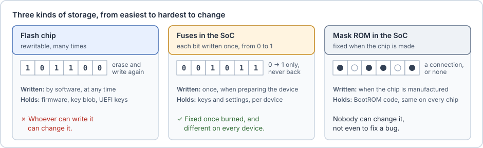
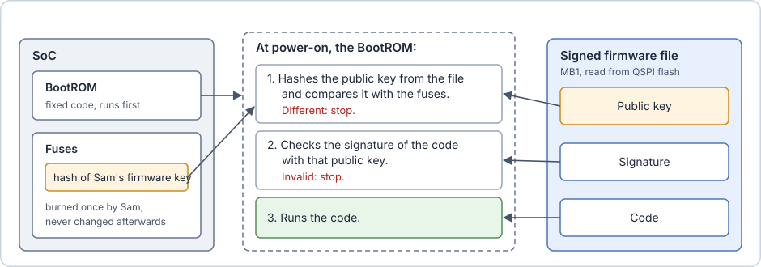
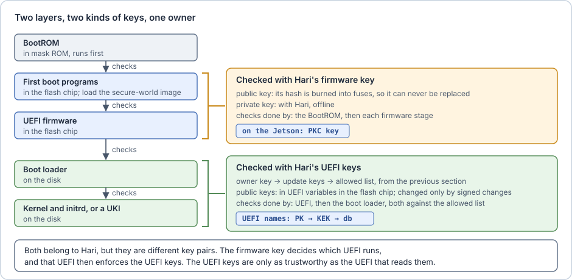
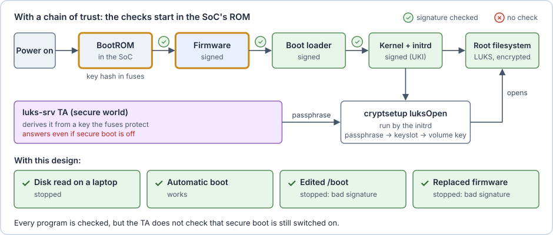
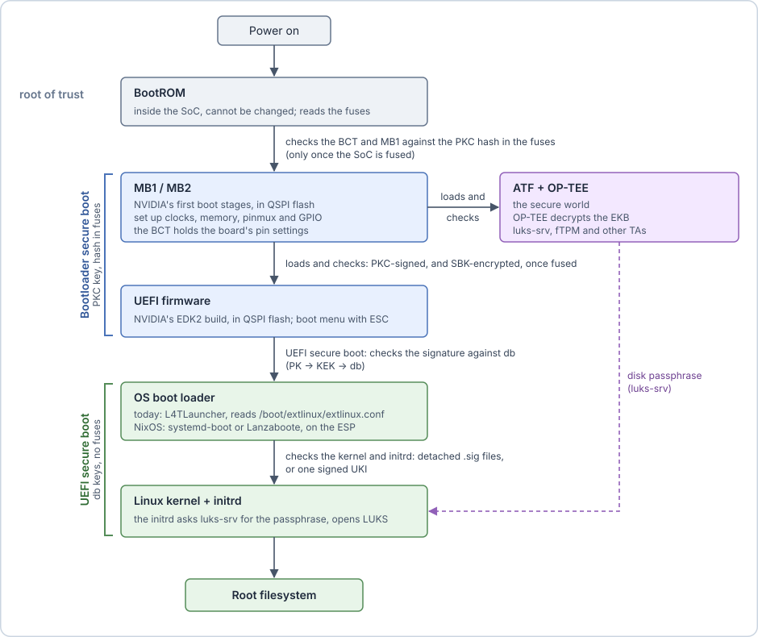

# Who checks the firmware

**The attack.** The attacker connects a USB cable, starts the robot in recovery mode and loads their own firmware, one that skips every signature check. The modified initrd runs again.

> [!info] Recovery mode
> A mode built into the SoC for installing firmware (NVIDIA calls it RCM). If a jumper is set, or a button held, at power-on, the device does not start the firmware in its own flash memory. It waits for a computer on the USB port to send the software to run. NVIDIA's `flash.sh` uses this to install firmware. Without the fuses described below, it accepts any software; with them, only software signed with Hari's firmware key, described below.

**The idea: a chain of trust that starts in hardware.** Each stage checks the signature of the next stage before running it. The chain needs a first link that nobody can change: if the first stage could be replaced, it could be replaced by one that checks nothing.

On the Orin, the first link is the **BootROM**: code in read-only memory (ROM) inside the SoC, written when the chip is made and impossible to change afterwards.

> [!info] Read-only memory (ROM)
> **Read-only memory** (ROM) holds data that can be read but never written. Inside a SoC it is usually **mask ROM**: its contents are part of the chip's structure. Each bit is a spot in a grid where a connection either exists or not, and that pattern is laid down in the **masks**, the templates from which every chip of a design is printed during manufacturing. Every chip of that design therefore carries the same contents, and no voltage, command or tool can change them afterwards.
>
> The primer has now met three kinds of storage. The flash chip can be rewritten by software at any time. Fuses are written once per device, each bit only from 0 to 1. Mask ROM is fixed for every chip at the factory. That makes it the right place for the first program: an attacker who controls the software, the flash chip and the USB port still cannot change a single bit of it.
>
> The price is that a bug in ROM code can never be fixed. In 2018, researchers found a bug in the recovery mode of the Tegra X1 BootROM (CVE-2018-6242), the SoC in the die photo above. It let anyone with a USB cable run their own code before any signature check. The chips already sold could not be repaired, and only a new chip revision closed the hole.
>
> 

**Which key does the BootROM check against?** Not one of the UEFI keys from the previous section. Those keys are stored in UEFI variables in the flash chip, which is exactly what the attacker replaces, and the BootROM runs long before UEFI exists. The BootROM needs a public key stored where nobody can change it: in fuses. So Hari makes one more key pair, the **firmware key**. It signs only the firmware itself: the first boot programs after the BootROM, the secure-world image, and UEFI. Like the owner key, it belongs to Hari and its private key stays offline, but it is a separate key pair with a separate job.

There are few fuses, so they hold only the hash of the firmware key's public key. Each signed firmware file carries the full public key. The BootROM hashes that key, compares the result with the fused hash, and only then uses the key to check the signature. Each firmware stage then checks the next one with the same key, up to UEFI.

**Two keys, one after the other.** From UEFI on, the UEFI keys take over: UEFI checks the boot loader against its allowed list, and the boot loader checks the kernel and the initrd. The firmware key decides which UEFI runs, and that UEFI then enforces the owner key, the update keys and the two lists. The UEFI keys are therefore only as trustworthy as the firmware that reads them, which is why both layers are needed.

**No key above the firmware key.** Unlike the UEFI keys, the firmware key cannot be replaced by a signed change. There is no update key or owner key above it, because its hash sits in fuses. If its private key leaks, anyone can sign firmware that Hari's robots accept. If it is lost, they can never receive new firmware (see [What none of this protects](07-what-none-of-this-protects.md)).

Two more fuses complete the design:

- **Hiding the firmware.** Signatures stop changes, but anyone can still read the firmware from flash and study it. The firmware can also be encrypted with an AES key burned in fuses, the **SBK** (Secure Boot Key). The flash then holds only encrypted firmware.
- **Switching the checks on.** The BootROM enforces signatures only once the fuse `SecurityMode` (production mode) is burned. This fuse also blocks all further fuse writes, so it is burned last. Until then, keys can be burned and tested while unsigned firmware still boots.

With a chain of trust, Hari's boot looks like this:

> [!example] On the Jetson
> The Orin has more boot stages than a PC, because the SoC must set up its memory and the secure world before UEFI runs:
> - **MB1** and **MB2** are NVIDIA's first boot stages after the BootROM, stored in QSPI flash. They set up clocks, memory and the SoC pins. Their settings come from the **BCT** (Boot Configuration Table), which includes the **pinmux**: the function of each SoC pin. Board-specific pin settings live there.
> - MB2 loads ATF and OP-TEE, then UEFI.
> - Hari's firmware key is what NVIDIA calls the **PKC** key (from public key cryptography). Its hash goes into the fuse `PublicKeyHash`.
> - **Modules ship with no fuse burned**, so until they are fused, recovery mode accepts any firmware.

The full boot of the Jetson, with the two layers of checks:

The two layers use different keys and are switched on in different ways:

| Layer                                    | Who checks        | What it checks                                   | Keys                                                               | Enforced when                          |
| ---------------------------------------- | ----------------- | ------------------------------------------------ | ------------------------------------------------------------------ | -------------------------------------- |
| **Bootloader secure boot** (NVIDIA)      | BootROM, MB1, MB2 | Everything in QSPI: BCT, MB1, MB2, OP-TEE, UEFI… | Hari's firmware key (NVIDIA: PKC) to sign, SBK to encrypt           | Fuses burned, including `SecurityMode` |
| **UEFI secure boot** (industry standard) | UEFI firmware     | EFI binaries it loads: boot loader, kernel, UKIs | Hari's owner key → update keys → allowed list (UEFI: PK → KEK → db) | PK enrolled (no fuses needed)          |

With both layers on, the chain is unbroken from the BootROM to the kernel. UEFI secure boot alone is only as strong as the firmware that runs it: on a module without fuses, recovery mode can replace UEFI with one that checks nothing.

**What is still missing.** Every program is now checked before it runs, but only while secure boot is switched on with Hari's keys. The TA that hands out the disk passphrase does not check that: it still answers the first program that asks.
