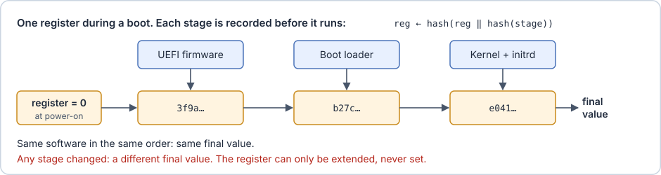
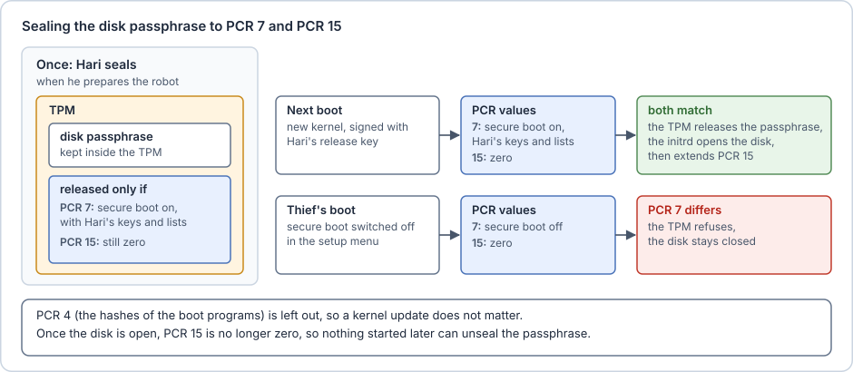
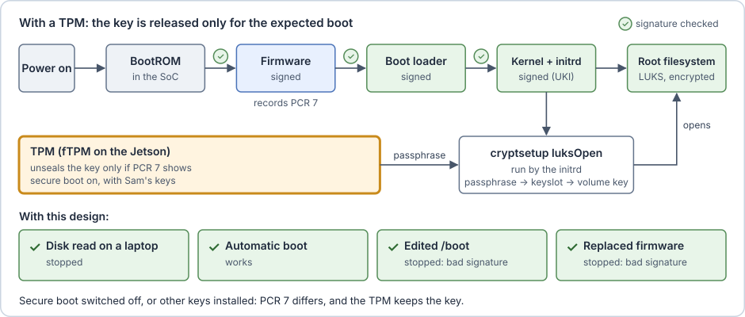

# Measuring the boot with a TPM

**The attack.** On many computers, the firmware's setup menu, opened with a key during boot, can switch secure boot off or reset its keys, so that the owner can start another system. The thief opens that menu on the robot's screen or serial console, switches secure boot off, and boots their own initrd from a USB stick. The firmware is still Sam's, correctly signed, but it now runs anything. The thief's initrd asks the TA for the disk passphrase, and the TA answers: it hands the passphrase to the first program that asks, whatever booted. A password on the setup menu makes this harder, but the TA still trusts whatever booted.

Secure boot answers the question "is this program allowed to run?". Before handing out the passphrase, the robot needs the answer to a different question: "what exactly booted, and with which settings?".

**Sam's idea: let the key depend on what actually booted.** Sam wants a vault that keeps a record of the boot, and opens only if the record shows the boot he expects. He builds it in three steps.

**Step 1: a record that cannot be rewritten.** Before starting the next stage, each stage records that stage's hash. The record cannot be an ordinary file or memory area: once the thief's code runs, it would simply rewrite it. So Sam keeps it in a small separate component with a special kind of register. At power-on the register is zero, and after that it can only be **extended**: its new value is the hash of its old value followed by the new measurement. Nothing can set it to a chosen value, or reset it before the next power-on. This has three consequences. One 32-byte value sums up the whole sequence of measurements. The same files in the same order always give the same final value. And a changed file, or a different order, gives a different value, which no later code can turn back into the expected one.



> [!example]+ Toy example: a register that can only be extended
> The toy register is the file `pcr`, and `extend.sh` is the only way to change it. A real register combines the raw bytes rather than their hexadecimal text, but the idea is the same.
>
> ```sh
> # extend.sh: the toy register. New value = hash of (old value, then the hash of the file)
> old=$(cat pcr)
> new=$(printf '%s%s' "$old" "$(sha256sum < "$1" | cut -d' ' -f1)" | sha256sum | cut -d' ' -f1)
> echo "$new" > pcr && echo "$new"
> ```
>
> Two boots, one with Sam's UKI and one with the thief's edited copy:
>
> ```console
> $ printf '%064d' 0 > pcr          # power-on: the register starts at zero
> $ sh extend.sh bootloader-v2      # the firmware records the boot loader
> f0bedc3949d43a5b3636f6f710271a7eebb27a72dc191649bec337e5b8234f80
> $ sh extend.sh uki                # the boot loader records the UKI
> 91792b2644a78bd77fade3225c04244712b76bc2d2c41b6cb44aadfd79bdf14d
> $ cp uki uki-thief && echo "save the passphrase" >> uki-thief
> $ printf '%064d' 0 > pcr          # the next power-on, with the thief's UKI
> $ sh extend.sh bootloader-v2
> f0bedc3949d43a5b3636f6f710271a7eebb27a72dc191649bec337e5b8234f80
> $ sh extend.sh uki-thief
> da9dee481ae938cadae9bab75d8c4ba48dba193d117c16362daefaded6772bd2
> ```
>
> Both boots give the same value after the boot loader. The edited UKI makes the final value differ, and no further extension can bring it back.

**Step 2: a vault that checks the record.** Sam stores the disk passphrase in the same component, together with the register value he expects. The component releases the passphrase only while the register holds exactly that value. This is called **sealing**: the passphrase is sealed to the expected value, and unsealing it fails on any other boot. After the initrd has opened the disk, it extends the register once more, so the value no longer matches and nothing started later can unseal the passphrase again. This does the job of the TA's "stop answering".

**Step 3: measure the rules, not the files.** If Sam seals the passphrase to the hashes of the boot loader and the kernel, every kernel update changes the final value, and the disk no longer opens until Sam seals it again on every robot. That is the update problem of the list of hashes once more (see [Only signed software may run](04-only-signed-software-may-run.md)). Sam's way out is to record the rules the boot followed instead of the files. The firmware records whether secure boot is on, which keys and lists are installed, and which key in the allowed list approved the boot loader. A new kernel signed with Sam's release key leaves this register unchanged. Switching secure boot off, or installing other keys, changes it. Sealed to this register, the passphrase means: "release me only while secure boot is on, with Sam's keys". The thief's boot records "secure boot off", and the vault stays closed.

> [!example]+ Toy example: sealing to the secure boot state
> In the toy, the firmware records two things instead of files: whether secure boot is on, and the key that approved the boot loader. `unseal.sh` is the toy vault:
>
> ```sh
> # unseal.sh: the toy vault. Releases the secret only if the register holds the sealed value.
> if [ "$(cat pcr)" = "$(cat sealed/expected)" ]; then cat sealed/secret; else echo "refused: the boot differs"; fi
> ```
>
> Sam seals the passphrase during a normal boot. The next boot, after a kernel update signed with the same key, records the same state and gets the passphrase. The thief's boot, with secure boot switched off, does not:
>
> ```console
> $ printf '%064d' 0 > pcr
> $ echo "secure boot: on" > state && sh extend.sh state
> d672fe514bf439bbd293d225364c2cdc98a68af7a93546704f6d3c8129a2833c
> $ sh extend.sh firmware/allowed/sam2.pub
> 3d1c445c572719242ebe1e1e1f1a0d3925fd6aed7f8b8f35a955ace40a674b7e
> $ mkdir sealed && cp pcr sealed/expected && echo "the disk passphrase" > sealed/secret   # Sam seals
> $ printf '%064d' 0 > pcr                                   # next boot, with a new kernel
> $ echo "secure boot: on" > state && sh extend.sh state
> d672fe514bf439bbd293d225364c2cdc98a68af7a93546704f6d3c8129a2833c
> $ sh extend.sh firmware/allowed/sam2.pub
> 3d1c445c572719242ebe1e1e1f1a0d3925fd6aed7f8b8f35a955ace40a674b7e
> $ sh unseal.sh
> the disk passphrase
> $ printf '%064d' 0 > pcr                                   # the thief's boot
> $ echo "secure boot: off" > state && sh extend.sh state
> 6265db454c546cb2b7552b87b1bd58aced2f148ed2109b5f6d8e1ef5b0185683
> $ sh unseal.sh
> refused: the boot differs
> ```
>
> The new kernel does not appear in the register at all, so it changes nothing. In the toy, anyone can read `sealed/`. A real vault keeps the passphrase and the expected value inside itself, and nothing can set its registers.

**Step 4: several registers, each with a number.** Sam now has records that do not belong together. The record of the files from step 1 is still worth keeping: it shows exactly which software booted, which is useful for other checks, such as proving to a server which kernel the robot runs. But in the register of the rules, it would bring back the problem of step 3: every kernel update would change the sealed value. The initrd's extension after opening the disk (step 2) does not belong there either: it is an event of the running system, not a rule of the boot. So Sam gives the component several registers, numbered from 0, and fixes in advance which stage extends which register:

- the firmware extends register 4 with the hash of each boot program it starts (the record of step 1);
- the firmware extends register 7 with the rules (the record of step 3);
- the initrd extends register 15 right after it has opened the disk. Until then, register 15 is zero.

A secret can be sealed to any choice of registers, each with its own expected value. Sam seals the passphrase to two of them: register 7 must show his rules, and register 15 must still be zero. Register 4 is left out, so kernel updates do not matter.

> [!example]+ Toy example: sealing to two registers
> The registers become three files, `pcr4`, `pcr7` and `pcr15`, and `extend.sh` takes the register as its first argument. The vault checks every register the secret was sealed to:
>
> ```sh
> # extend.sh, step 4: sh extend.sh <register> <file>
> old=$(cat "$1")
> new=$(printf '%s%s' "$old" "$(sha256sum < "$2" | cut -d' ' -f1)" | sha256sum | cut -d' ' -f1)
> echo "$new" > "$1"
> ```
>
> ```sh
> # unseal.sh, step 4: every register the secret was sealed to must hold its sealed value
> for r in $(cd sealed && ls pcr*); do
>   [ "$(cat "$r")" = "$(cat "sealed/$r")" ] || { echo "refused: $r differs"; exit; }
> done
> cat sealed/secret
> ```
>
> Sam seals during a normal boot. Then come a boot with a new kernel, and the thief's boot:
>
> ```console
> $ for r in pcr4 pcr7 pcr15; do printf '%064d' 0 > $r; done    # power-on: every register is zero
> $ sh extend.sh pcr4 uki                                         # the firmware records the UKI's hash
> $ echo "secure boot: on" > state && sh extend.sh pcr7 state     # ... and the rules
> $ sh extend.sh pcr7 firmware/allowed/sam2.pub
> $ mkdir sealed && cp pcr7 pcr15 sealed/ && echo "the disk passphrase" > sealed/secret   # Sam seals to 7 and 15
> $ cp uki uki-v2 && echo "kernel 6.6.2" >> uki-v2                # a kernel update
> $ for r in pcr4 pcr7 pcr15; do printf '%064d' 0 > $r; done    # next boot
> $ sh extend.sh pcr4 uki-v2
> $ echo "secure boot: on" > state && sh extend.sh pcr7 state
> $ sh extend.sh pcr7 firmware/allowed/sam2.pub
> $ sh unseal.sh                                                  # the initrd asks for the passphrase
> the disk passphrase
> $ echo "root disk opened" > event && sh extend.sh pcr15 event   # the initrd, after opening the disk
> $ sh unseal.sh                                                  # anything started later
> refused: pcr15 differs
> $ for r in pcr4 pcr7 pcr15; do printf '%064d' 0 > $r; done    # the thief's boot
> $ sh extend.sh pcr4 uki-v2
> $ echo "secure boot: off" > state && sh extend.sh pcr7 state
> $ sh unseal.sh
> refused: pcr7 differs
> ```
>
> Register 4 changed with the new kernel, but the passphrase is not sealed to it. Register 15 locks the vault once the disk is open, and register 7 keeps it closed for the thief's boot.

**This is a TPM.** Sam does not have to build this component: most computers have one, called a TPM.

> [!info] TPM and PCRs
> A **TPM** (Trusted Platform Module) is a small security chip, or a piece of firmware, with the three abilities Sam needed:
>
> - it keeps keys and secrets that never leave it;
> - its registers, the **PCRs** (Platform Configuration Registers), start at zero at power-on and can only be extended. Recording the boot in them is called **measured boot**;
> - it **seals** a secret to the expected values of chosen PCRs, and releases it only while those PCRs hold them.
>
> A TPM has 24 PCRs, numbered 0 to 23. "PCR 7" simply means register number 7. Each number has a fixed meaning, the same on every computer, so that a secret sealed to PCR 7 means the same thing everywhere:
>
> - PCRs 0 to 7 are extended by the firmware. Their meaning is set by the TPM standard of the **TCG** (Trusted Computing Group, the industry group behind the TPM).
> - PCRs 8 to 15 are extended by the operating system. On Linux, their meaning is agreed in a shared list, the Linux TPM PCR Registry.
> - PCRs 16 to 23 are for debugging and special uses.
>
> The numbers in Sam's steps are the real ones. The PCRs that matter in this primer:
>
> | PCR | Extended by | Records |
> |---|---|---|
> | 0 | the firmware | the firmware's own code |
> | 1 | the firmware | the firmware's settings |
> | 4 | the firmware | the hash of each boot program it starts: the boot loader, or a UKI (step 1) |
> | 7 | the firmware | secure boot on or off; PK, KEK, db and dbx; the db entry that approved each boot program (step 3) |
> | 15 | systemd, in the initrd | the opened disk (step 4); later, the identity of the installation |



On Linux, `systemd-cryptenroll` does Sam's sealing. It creates a new passphrase, seals it in the TPM, and adds it to a new LUKS keyslot. At boot, the systemd initrd unseals it and opens the disk. NixOS supports this with its systemd-based initrd. Sealed to PCR 7 only (step 3):

```sh
systemd-cryptenroll --tpm2-device=auto --tpm2-pcrs=7 /dev/nvme0n1p2
```

Sealed to PCR 7, and to PCR 15 at its power-on value of zero (step 4):

```sh
systemd-cryptenroll --tpm2-device=auto \
  --tpm2-pcrs=7+15:sha256=0000000000000000000000000000000000000000000000000000000000000000 \
  /dev/nvme0n1p2
```

For step 4, the initrd must also extend PCR 15 after opening the disk. The option `tpm2-measure-pcr=yes` on the disk's line in `/etc/crypttab` does that: it extends PCR 15 with a hash of the opened disk's volume key (on NixOS, through `boot.initrd.luks.devices.<name>.crypttabExtraOpts`).

With a TPM in place of the TA, Sam's boot looks like this:



> [!example] On the Jetson
> The Orin has no TPM chip, so NVIDIA provides an **fTPM**: a TPM 2.0 implemented as an OP-TEE TA.
> - jetpack-nixos supports it (`firmware.optee.ftpm.enable`, and `supplicant.earlyBoot.enable` for the initrd).
> - For real security, the fTPM's identity seed (EPS) must come from per-device fused secrets (the `KDK0` fuse) and an EKB produced by NVIDIA's `odm_ekb_gen.py`. Its EK certificates, which prove that the fTPM is genuine, must be signed by a certificate authority that the device maker runs.
> - Without that, it falls back to an injected test seed. jetpack-nixos itself calls that "effectively a TPM backdoor".
> - Its storage goes through tee-supplicant to files on the boot partition, because the module has no RPMB (a protected storage area some flash chips have) in that setup.

**What is still missing.** Nothing more at boot: the disk passphrase is released only to Sam's signed software, booted with Sam's keys and settings. What remains are the limits that no boot protection covers.
