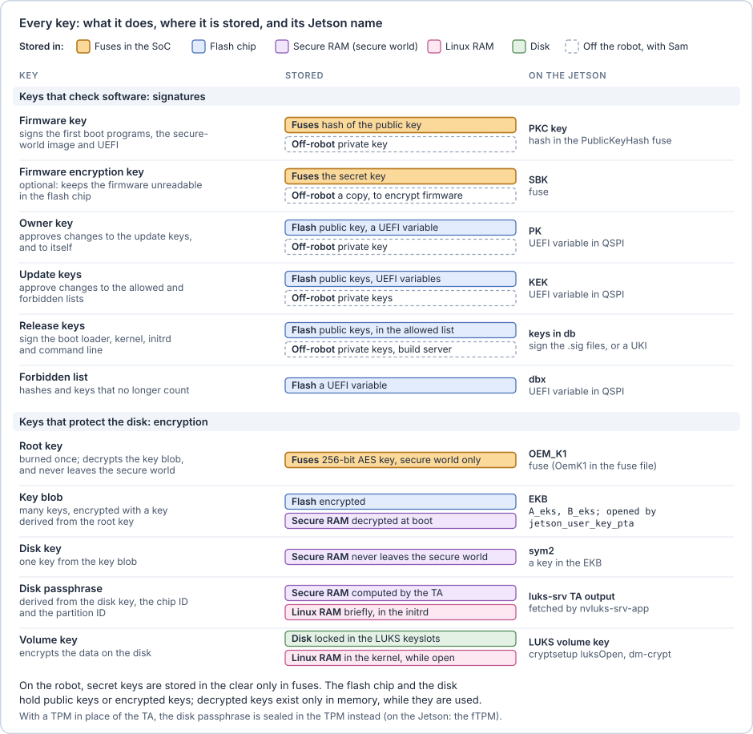
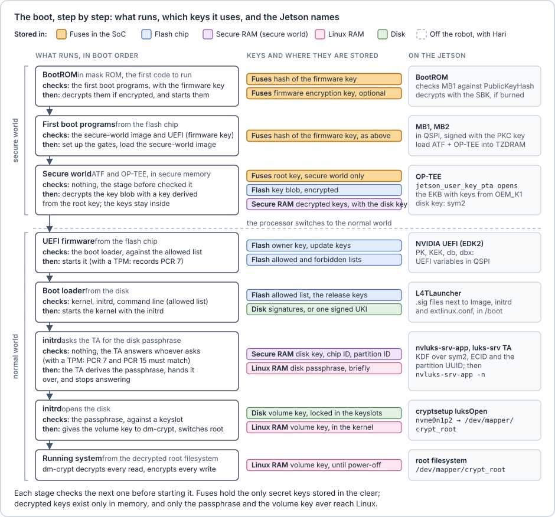

# The whole picture

The first figure lists every key in this primer: what it does, where it is stored, and its Jetson name. The colour of each box shows where the key is stored. Fuses in the SoC are the only place on the robot where a secret key is stored in the clear.

The second figure follows the boot from power-on to the running system, in the same colours. For each stage it shows what the stage checks before starting the next one and what it does afterwards, which keys it uses and where they are stored, and the Jetson name.

Each stage is checked by the stage before it. An attacker who changes any piece, whether the firmware, the kernel, the initrd or the command line, either fails a signature check or, with fTPM sealing, gets a TPM that refuses to unseal. The EKB taken from QSPI is useless without OEM_K1, and OEM_K1 never leaves the fuses and the secure world.
